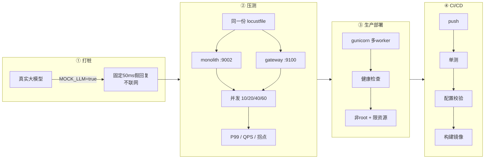
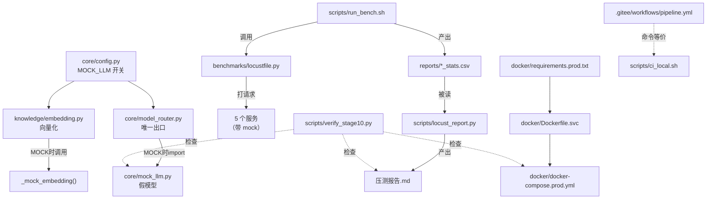
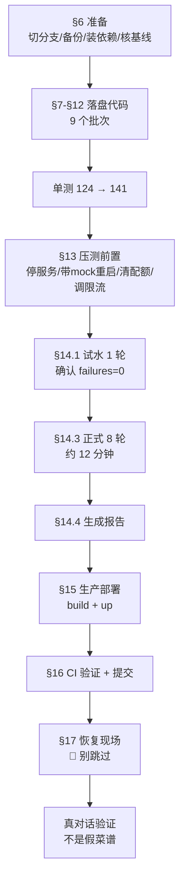
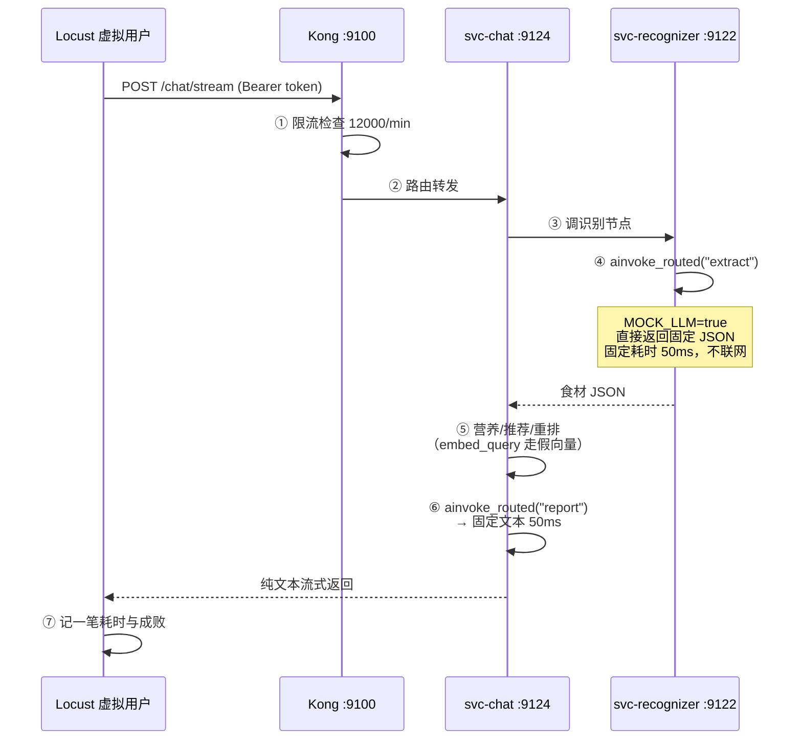

# AI 私厨 v3.0 · 阶段 10 理解手册
## 大白话 + 图解：这一阶段到底干了什么

> **这份手册和另外两份的分工**：
> - 《操作手册》= 照着做（建文件、贴代码、跑命令）
> - 《说明手册》= 看懂为什么（逐行代码解释 + 专业名词）
> - **《理解手册》（本文件）= 搞懂全貌**（大白话 + 图解，讲清"这些文件之间怎么联动"）
>
> 🔴 **本手册绝不重复说明手册的逐行代码解释**。这里只讲"整体是怎么运转的"。
> 每张图都给 **ASCII 版 + Mermaid 版** 两份，并在图后附一句「一句话记住」。

---

## 目录

- [一、一分钟版](#一一分钟版)
- [二、全景图：这一阶段的四块活](#二全景图这一阶段的四块活)
- [三、文件清单：改了什么、加了什么](#三文件清单改了什么加了什么)
- [四、代码是怎么实现目标的](#四代码是怎么实现目标的)
- [五、目录联动：文件之间怎么串起来](#五目录联动文件之间怎么串起来)
- [六、操作流程：从上到下做一遍](#六操作流程从上到下做一遍)
- [七、时序图：一次压测请求的一生](#七时序图一次压测请求的一生)
- [八、Q&A：最容易懵的十个问题](#八qa最容易懵的十个问题)
- [九、面试话术](#九面试话术)

---

## 一、一分钟版

如果你只有一分钟，记住这三句：

1. **先给大模型装了个"假体外挂"**（`MOCK_LLM` 开关）。因为压测想测的是"我的架构能扛多少"，不是"阿里云的网速快不快"。不摘掉外部模型，两次跑的数字能差一倍。

2. **然后用同一份脚本打两个架构**（单体 9002 vs 微服务+网关 9100），从 10 并发一路加到 60 并发，看谁先崩。结果：**单体在 60 并发崩了（P99 从 290ms 跳到 3900ms），微服务同样 60 并发只有 670ms**。

3. **最后把项目从"能跑"升级成"能交付"**：容器用 gunicorn 多 worker 起、挂健康检查、非 root 运行、限资源；提交代码自动跑测试和构建（CI）。

**一句话记住**：阶段 10 是把"我觉得拆分更好"变成"我测出来拆分好多少"，并且让这套东西能被别人接手部署。

---

## 二、全景图：这一阶段的四块活

### ASCII 版

```
┌─────────────────────────────────────────────────────────────┐
│                    阶段 10：四块活                            │
└─────────────────────────────────────────────────────────────┘

 ① 打桩（Mock）              ② 压测（Locust）
 ┌──────────────────┐        ┌──────────────────────────────┐
 │ 真实大模型调用     │        │ 同一份脚本，打两个地址          │
 │        ↓          │        │                              │
 │ MOCK_LLM=true     │        │  monolith → 127.0.0.1:9002   │
 │        ↓          │   →    │  gateway  → 127.0.0.1:9100   │
 │ 固定 50ms 假回复   │        │                              │
 │ （不联网）         │        │  并发 10 → 20 → 40 → 60      │
 └──────────────────┘        │        ↓                      │
                             │  P99 / QPS / 失败率 / 拐点      │
                             └──────────────────────────────┘

 ③ 生产部署                   ④ CI/CD
 ┌──────────────────┐        ┌──────────────────────────────┐
 │ gunicorn 多 worker │        │ push 代码                     │
 │ + ASGI worker 类   │        │    ↓                         │
 │ + 健康检查         │   →    │ Gitee Go 自动跑              │
 │ + 非 root 用户     │        │   ① 单元测试                  │
 │ + 资源/日志上限    │        │   ② 配置校验                  │
 └──────────────────┘        │   ③ 构建镜像                  │
                             │                              │
                             │ 附：ci_local.sh 本地先跑一遍   │
                             └──────────────────────────────┘
```

### Mermaid 版



**一句话记住**：①让测量变准 → ②拿到数字 → ③让它能上线 → ④让它能被别人接手。四步是递进关系，顺序不能倒。

---

## 三、文件清单：改了什么、加了什么

### ASCII 版：按"作用"分组

```
【业务代码】改了 3 个 + 新建 1 个
────────────────────────────────────────
  app_my/core/mock_llm.py          🟢新建  假模型本体
  app_my/core/config.py            🔵改    加 MOCK_LLM 开关
  app_my/core/model_router.py      🔵改    在唯一出口接上假模型
  app_my/knowledge/embedding.py    🔵改    向量化也打桩（漏网之鱼）

【压测】新建 4 个
────────────────────────────────────────
  benchmarks/locustfile.py         🟢 虚拟用户做什么
  scripts/run_bench.sh             🟢 编排（Git Bash）
  scripts/run_bench.ps1            🟢 编排（PowerShell）
  scripts/locust_report.py         🟢 CSV → Markdown 报告

【生产部署】新建 3 个
────────────────────────────────────────
  docker/requirements.prod.txt     🟢 生产依赖清单
  docker/Dockerfile.svc            🟢 生产镜像定义
  docker/docker-compose.prod.yml   🟢 生产编排

【CI/CD】新建 3 个
────────────────────────────────────────
  .gitee/workflows/pipeline.yml    🟢 云端流水线
  scripts/ci_local.sh              🟢 本地等价验证（Git Bash）
  scripts/ci_local.ps1             🟢 本地等价验证（PowerShell）

【验收】新建 1 个
────────────────────────────────────────
  scripts/verify_stage10.py        🟢 33 项验收

【测试】已写入 2 个（无需你动手）
────────────────────────────────────────
  tests/unit/test_stage10_mock_llm.py        8 个用例
  tests/unit/test_stage10_bench_report.py    9 个用例
```

**一句话记住**：14 个新建 + 3 个修改 + 2 个已写好的测试 = 19 个文件，但**核心业务代码只动 4 个**，其余全是"工具"。

---

## 四、代码是怎么实现目标的

这一章讲"目标 → 代码"的映射，不重复逐行解释。

### 4.1 目标①：让压测测的是自己

```
目标：把外部大模型调用从压测链路里摘掉
                ↓
难点：调用散落在 recognizer / output 两个节点里
                ↓
突破口：grep 发现全项目只剩 model_router.ainvoke_routed 一处真调用
                ↓
做法：在这个唯一出口加一个"早返回"分支
                ↓
结果：一行业务代码都不用改；关掉开关立刻恢复
```

**为什么这一步要拆成 4 个文件？**

| 文件 | 承担什么 | 少了它会怎样 |
|---|---|---|
| `mock_llm.py` | 假模型本体（给什么内容、耗多久） | 没有东西可替换 |
| `config.py` | 开关（`MOCK_LLM`） | 无法临时启用/关闭，只能改代码 |
| `model_router.py` | 接线（在哪替换） | 有假模型但没人用它 |
| `embedding.py` | 补漏网的（向量化也是外部调用） | chat 场景每次还在联网，测出来仍然不准 |

> 🔴 **第四个文件是最容易漏的**。`embedding.py` 不在 `model_router` 的出口上，但 `/chat/stream` 每次请求都要把用户问题向量化一次去查本地菜谱库。只改前三个，**压测时每一次对话仍然在联网**。

### 4.2 目标②：拿到能写进简历的数字

```
目标：证明"拆分值不值"
                ↓
难点：不能只跑一次，要能对比、要能找拐点
                ↓
做法：
  · 同一份 locustfile 打两个地址  → 消除"脚本不同"这个变量
  · 并发从 10 加到 60（4 档）      → 才能看见"什么时候开始崩"
  · 三场景权重 3/2/5               → 一个测 CPU、一个测体验、一个测上限
                ↓
结果：8 个 CSV → locust_report.py → 三张表 + 拐点结论
```

**为什么要"三个场景"而不是只压一个？**

- **登录（权重 3）**：慢在 bcrypt 密码哈希，**CPU 密集**。它能量出"CPU 被密码计算吃掉多少"。拆分后这部分被摊到多个进程，收益最大（实测 -81%）。
- **对话（权重 2）**：全项目最重的链路，串五个节点 + 碰向量库 + 碰图谱。它反映"用户感知的响应时间"。拆分后它要**多跳一次网关**，所以这里是**代价**（+51%）。
- **图谱（权重 5）**：最轻。用它把"架构本身的极限 QPS"顶出来。

> 只压一个场景，你只能得到半个答案。**收益和代价都要有数字**，结论才可信。

### 4.3 目标③：从"能跑"到"能交付"

| 本机开发 | 生产容器 | 解决了什么问题 |
|---|---|---|
| `uvicorn main:app` 单进程 | `gunicorn` 管 2~3 个 worker | 用满多核；worker 挂了自动拉起 |
| 无 worker 类概念 | `-k uvicorn.workers.UvicornWorker` | 服务是异步（ASGI），用同步 worker 会把异步堵死 |
| 无健康检查 | `HEALTHCHECK` 每 30 秒探 `/health` | 容器"起来了但应用没起来"时能自动发现 |
| Windows 用户 | `appuser`（uid 1000） | 被攻破时损失可控 |
| 日志直接看终端 | `--access-logfile -` + 日志轮转 | 日志能被采集；不会写满磁盘 |
| 无限制 | `mem_limit: 768m` / `cpus: 1.0` | 一个服务内存泄漏不拖死整机 |

**一句话记住**：生产部署解决的不是"能不能跑"，是"跑了会不会出事、出事能不能自愈、出事损失多大"。

### 4.4 目标④：提交前就知道会不会挂

```
云端 CI 的痛点：YAML 只能推上去才知道对不对，一来一回几分钟
                ↓
做法：把流水线里每条命令抄一份到 ci_local.sh，本机先跑一遍
                ↓
能证明：这些命令本身是通的
不能证明：云端一定接受这份 YAML 的语法（这个只能 push 后看）
```

> 🔴 **不要说"我验证过 CI"**。诚实的表述是："流水线里的命令我在本机都跑通了，云端 YAML 语法要 push 后才能确认。"

---

## 五、目录联动：文件之间怎么串起来

### ASCII 版：依赖方向（箭头 = "被谁用"）

```
                    ┌─────────────────────┐
                    │  app_my/core/       │
                    │    config.py        │ ← 加 MOCK_LLM 开关
                    └──────────┬──────────┘
                               │ 被读
              ┌────────────────┼────────────────┐
              ↓                ↓                ↓
   ┌──────────────────┐ ┌─────────────┐ ┌─────────────────┐
   │ model_router.py  │ │ embedding.py│ │  （其他业务代码） │
   │  唯一出口         │ │  向量化      │ │   一行都没改      │
   └────────┬─────────┘ └──────┬──────┘ └─────────────────┘
            │ import           │ 用
            ↓                  ↓
   ┌──────────────────┐ ┌─────────────────┐
   │  mock_llm.py     │ │ _mock_embedding │
   │  假模型本体       │ │ （就在这个文件里）│
   └──────────────────┘ └─────────────────┘

        ↑ 只在 MOCK_LLM=true 时加载，平时零开销


   ┌──────────────────────────────────────────────────────┐
   │                    压测链路                            │
   │                                                       │
   │  run_bench.sh ──调用──> locustfile.py                 │
   │       │                       │                        │
   │       │ 产出 CSV              │ 打 HTTP 请求            │
   │       ↓                       ↓                        │
   │  reports/bench_xxx/*.csv   5 个服务（带 mock）          │
   │       │                                                │
   │       │ 被读                                           │
   │       ↓                                                │
   │  locust_report.py ──产出──> 压测报告.md                │
   └──────────────────────────────────────────────────────┘


   ┌──────────────────────────────────────────────────────┐
   │                   部署与 CI 链路                       │
   │                                                       │
   │  requirements.prod.txt ──被 COPY──> Dockerfile.svc    │
   │                                        │              │
   │                        ┌───────────────┘              │
   │                        ↓                              │
   │            docker-compose.prod.yml（build + 起容器）   │
   │                                                       │
   │  pipeline.yml ──命令等价──> ci_local.sh               │
   │                                                       │
   │  verify_stage10.py ──检查──> 上面所有文件 + 服务 + 报告 │
   └──────────────────────────────────────────────────────┘
```

### Mermaid 版



### 5.1 三条依赖铁律（顺序错了就跑不起来）

| # | 顺序 | 反了会怎样 |
|---|---|---|
| 1 | `requirements.prod.txt` → `Dockerfile.svc` → `compose.prod.yml` | Dockerfile 要 `COPY` 前者，compose 要 `build.dockerfile` 指向后者。**反过来建，构建一定失败** |
| 2 | `mock_llm.py` → `config.py` → `model_router.py` | 有假模型没开关 = 没法启用；有开关没接线 = 没人用它 |
| 3 | 停进程 → 改配置 → 起进程 | Python 改完不重启，进程里还是旧代码；Kong 改完不重启，DB-less 配置不加载 |

**一句话记住**：**被别人引用的东西必须先存在**。这是阶段 7 就立下的铁律，本阶段又踩中了三次。

---

## 六、操作流程：从上到下做一遍

### ASCII 版

```
 准备（§6）
  切分支 → 恢复 Kong 原值并备份 → 装 locust/gunicorn → 核基线(124 passed)
     ↓
 落盘代码（§7~§12）        ← 7 个批次，顺序不能乱
   ① mock_llm.py（新建）
   ② config.py（加开关）
   ③ model_router.py（接线）
   ④ embedding.py（补漏网）
        ↓ 跑单测 → 应变成 141 passed
   ⑤ locustfile.py
   ⑥ run_bench.sh / .ps1 / locust_report.py
   ⑦ requirements.prod.txt → Dockerfile.svc → compose.prod.yml
   ⑧ pipeline.yml / ci_local.sh / .ps1
   ⑨ verify_stage10.py
     ↓
 跑压测（§13~§14）
   停服务 → 带 MOCK_LLM 重启 5 个 → 清配额 → 调高 Kong 限流并重启
     ↓
   试水 1 轮（15 秒）→ 确认 failures=0
     ↓
   正式 8 轮（2 目标 × 4 档 × 45 秒，约 12 分钟）
     ↓
   生成报告 → 三张表
     ↓
 生产部署 + CI（§15~§16）
   docker build（约 13 分钟）→ compose config → up -d → 看 healthy
     ↓
   ci_local.sh 全 PASS → verify_stage10.py 33 项 OK → git commit
     ↓
 恢复现场（§17）        ← 🔴 最容易跳过的一步
   Kong 限流改回 600/300/300/120 → 正常参数重启 5 个服务
     ↓
   发一条真对话，确认不是「【压测模式固定回复】」
```

### Mermaid 版



**一句话记住**：**准备 → 落盘 → 压测 → 部署 → 恢复**。恢复那一步不做，你下次开发会对着同一段假菜谱查半天 bug。

---

## 七、时序图：一次压测请求的一生

以"压网关、跑 /chat/stream 场景"为例，看一个请求从发出到返回经过了什么。

### ASCII 版

```
 Locust               Kong 9100          svc-chat 9124        svc-recognizer 9122
 (虚拟用户)                                  (SPLIT_MODE=remote)
    │
    │ POST /chat/stream
    │ Authorization: Bearer xxx
    ├─────────────────────>
    │                        │
    │                        │ ① 限流检查（rate-limiting 插件）
    │                        │    12000/min（压测时临时调高）
    │                        │
    │                        │ ② 路由匹配 /chat → svc-chat（Kong 路由不带 /api/v1 前缀）
    │                        ├─────────────────────>
    │                        │                        │
    │                        │                        │ ③ 开始跑链路
    │                        │                        │    识别节点
    │                        │                        ├──────────────────>
    │                        │                        │                   │
    │                        │                        │                   │ ④ ainvoke_routed("extract", ...)
    │                        │                        │                   │    ↓
    │                        │                        │                   │ MOCK_LLM=true
    │                        │                        │                   │ → 直接返回固定 JSON（50ms）
    │                        │                        │                   │   ⚡ 不联网
    │                        │                        │ <──────────────────┤
    │                        │                        │                   │
    │                        │                        │ ⑤ 营养/推荐/重排
    │                        │                        │    （embed_query 也走假向量）
    │                        │                        │
    │                        │                        │ ⑥ 出报告
    │                        │                        │    ainvoke_routed("report", ...)
    │                        │                        │    → 固定文本（50ms）
    │                        │                        │
    │  <──────────────────────────────────────────────┤
    │  纯文本流式返回（不是 SSE 的 data: 帧）
    │
 ⑦ Locust 记一笔：耗时 XX ms、成功/失败
```

### Mermaid 版



### 7.1 对照：压单体时少了哪一跳

```
压单体（9002）：
    Locust ──直接──> main:app（一个进程跑完全部节点）
                       │
                       └─ SPLIT_MODE 默认 local → 不跨服务，全部在自己进程内

压网关（9100）：
    Locust ──> Kong ──> svc-chat ──HTTP──> svc-recognizer
                                  ──HTTP──> svc-recommender
                                  ──HTTP──> svc-user
```

**这就是"+51% 网关开销"的来源**：微服务多了一跳网络 + 一次限流检查。

**但也是"-81% 登录 P99"的来源**：单进程里 60 个并发的 bcrypt 哈希全在抢同一颗 CPU；拆开后分摊到多个进程。

**一句话记住**：拆分不是"全面变快"，是**把 CPU 争抢换成网络跳转**。CPU 争抢在高压下会指数级恶化（290ms → 3900ms），网络跳转是固定开销（+51%）。所以并发越高，拆分越划算。

---

## 八、Q&A：最容易懵的十个问题

### Q1：为什么要先"打桩"再"压测"？直接压不行吗？

**不行，压出来的数字没有意义。** 真实大模型调用的耗时里混着：厂商的网络往返、厂商的排队、厂商的限流 429。这些**都不是你的系统问题**，但会被算进你的 P99 和错误率。同一套代码连跑两次能差一倍。面试官问"这个 QPS 是谁的 QPS"就答不上来。

### Q2：打桩会不会让压测"太假"？

**会有一点，而且是故意的。** 假模型固定耗 50ms，真实模型是几百毫秒到 2 秒。这是**有意压低**——好让架构自身的开销占主导，这样测出来的差异才归因于架构而不是模型。

如果你的目标是"评估端到端用户体验"，那就不该打桩；如果你的目标是"评估我的架构容量"（本阶段的目标），就该打桩。**目标决定方法**。

### Q3：为什么 P99 比平均值重要那么多？

看实测数据就明白了：

| 指标 | 单体 60 并发 | 微服务 60 并发 |
|---|---|---|
| 平均值 | 231ms | 130ms |
| **P99** | **3900ms** | **670ms** |

平均值只差 1.8 倍，看不出大事；**P99 差 5.8 倍**，而且 3900ms 意味着 1% 的用户等了将近 4 秒——这在真实产品里就是"卡死了"。

平均值会被大量快请求稀释，P99 反映"最倒霉的用户等多久"。

### Q4：拐点为什么是 60 并发，不是 40？

看实测数据：

| 并发 | 单体 P99 | 微服务 P99 |
|---|---|---|
| 10 | 290ms | 260ms |
| 20 | 290ms | 330ms |
| 40 | 390ms | 360ms |
| **60** | **3900ms** ⬆️ | 670ms |

单体在 40 并发时还是 390ms（没崩），到 60 并发突然跳到 3900ms（超过 1000ms 阈值）→ **拐点就是 60**。微服务最高档 670ms 仍未超阈值 → **未触及拐点**。

### Q5：为什么报告里"网关开销"用中位数，不用最大值？

因为**最大值会被偶发噪声带偏**。实测里 20 并发的 `/kg/ask` 出现过一次 310ms 的尖刺（增幅 +1967%），而 40 并发同样场景只有 21ms。如果取最大值，结论会变成"网关让图谱查询慢了 20 倍"——**完全是错的**。

取各档增幅的中位数（对话场景 +51%）才代表常态。

### Q6：gunicorn 在 Windows 上报 `No module named 'fcntl'`，是装错了吗？

**不是，这是正常的。** gunicorn 依赖 `fcntl` 和 `os.fork`，这两个 Windows 都没有。它**只能**跑在 Linux 容器里。

所以：装它（打进镜像用），但**永远不要在本机启动它**。看到一个"装了却不能跑"的东西会让人本能地觉得出错——这次是个例外。

### Q7：为什么 worker 数每个服务不一样（2/2/3/3）？

因为**负载类型不同**：

- `svc-user` 的登录是 bcrypt 密码哈希 = **CPU 密集** → worker 数 ≈ CPU 核数（2）。开再多也只是抢同一颗 CPU。
- `svc-recommender` 的图谱 + 向量检索 = **IO 密集** → 大部分时间在等数据库/网络 → 可以开多一些（3），把等待时间重叠掉。

一刀切设成同一个数是常见的错误。

### Q8：改了 kong.yml 为什么必须重启容器？

因为 Kong 跑在 **DB-less 模式**（`KONG_DATABASE: off`），配置全在那个 yaml 文件里。这个模式下 **Admin API 是只读的**——你没法通过接口热更新。

改文件 → `docker restart ai_chief_kong` → 等 10~15 秒（它要重新解析整个配置）。

### Q9：CI 流水线我到底算不算"验证过"？

**诚实地说：本机验证过命令，云端 YAML 语法未验证。**

云端 CI 的 YAML 只能推上去才知道对不对——它取决于云端怎么解析、云端环境装了什么。我做的是写 `ci_local.sh` 把每条命令在本机跑一遍，证明"命令本身是通的"。

面试时别说"我验证过 CI"，要说"流水线的命令我在本机都跑通了，云端 YAML 语法要 push 后才能确认"。

### Q10：为什么最后必须"恢复现场"？不恢复会怎样？

三件事会一直错下去：

1. **Kong 限流停在 60000** → 网关限流形同虚设，你以后想测限流功能，测不出来；
2. **服务带 `MOCK_LLM=true` 跑着** → **所有对话都返回同一段假菜谱**，而且接口返回 200、不报错，你查半天查不出原因；
3. **限流阈值停在 1000000** → 限流中间件等于关了。

第 2 条最阴险——**不报错的错误最难查**。所以操作手册专门在 §17.3 放了一条"发真请求看是不是假菜谱"的验证。

---

## 九、面试话术

### 9.1 简历上怎么写（可直接抄）

> **AI 私厨 v3.0 · 性能工程与工程效能**（个人项目，单机 Docker 环境）
>
> - 用 **Locust** 设计三场景压测（登录 / 流式对话 / 图谱多跳推理），对**拆分前后的两套架构做同脚本对比**，阶梯加压定位性能拐点：单体架构在 **60 并发**时 P99 从 290ms 劣化到 **3900ms**，而微服务架构同一档位 P99 仅 **670ms**（差 5.8 倍），定位到瓶颈是单进程内 bcrypt 密码哈希的 CPU 争抢，拆分后被分摊到多个进程。
> - 建立**性能打桩机制**（`MOCK_LLM` 开关 + 统一出口早返回），把大模型调用从压测链路中摘除，使压测结果只反映自身架构容量、可重复复现，避免被外部模型服务的波动污染。
> - 用 **Gitee Go** 建 CI 流水线（单测 → 配置校验 → 镜像构建），并提供本地等价验证脚本，把"CI 挂了才发现"变成"提交前就知道"。
> - 生产部署用 **Docker Compose + gunicorn（多 worker / ASGI worker 类）**，配健康检查、资源上限与日志轮转；容器非 root 运行。

### 9.2 三个"讲出来加分"的细节

**① 主动讲代价**

> "拆分不是全面变快。对话场景因为多跳一次网关，P99 中位数涨了 51%。但它换掉的是 CPU 争抢——那个东西在高压下会指数级恶化（290ms → 3900ms），而网络跳转是固定开销。所以并发越高，拆分越划算。只讲收益不讲代价的方案，我是不信的。"

**② 主动讲你怎么剔除噪声**

> "20 并发的图谱场景出现过一次 +1967% 的尖刺，那是一次冷连接/GC，不是常态。所以我用各档增幅的**中位数**下结论，而不是最大值。压测报告必须做这一步，否则结论会被一次 GC 带偏。"

**③ 主动讲你验证到什么程度**

> "云端 CI 的 YAML 我在本机跑不了，所以我写了本地等价脚本，能证明的是'这些命令本身是通的'，不能证明'云端一定接受这份语法'。这个区别我会讲清楚。"

### 9.3 被追问"你是怎么定位到 bcrypt 的"时

回答思路（别背，讲推理过程）：

1. 先看三个场景各自的曲线——**只有登录场景在 60 并发时暴涨**（210ms → 3000ms），对话和图谱都没怎么变；
2. 登录和另外两个的差别是什么？**只有 bcrypt 密码哈希**，它是 CPU 密集；
3. 单体是一个进程，60 个并发的 bcrypt 全在抢同一颗 CPU → 排队时间指数级上升；
4. 拆分后 user 服务独立成进程，加上 gunicorn 多 worker，压力被分摊 → 560ms。

> 这就是"**从数据反推瓶颈**"，比"我猜是数据库"强得多。

### 9.4 常见追问速查

| 追问 | 一句话答案 | 详见 |
|---|---|---|
| 这个 QPS 是谁的 QPS？ | 我自己的架构的，大模型已打桩摘除 | Q1 |
| 为什么默认不开 mock？ | 默认开着会让正常开发全是假数据，还查不出原因 | 说明手册 §5.3 |
| 向量打桩为什么用 md5？ | 内置 hash() 有 PYTHONHASHSEED 随机化，跨进程不一致 | 说明手册 §7.3 |
| 为什么打桩点在 model_router？ | 档位推不出任务格式；且它是唯一出口，一行业务代码都不用改 | 说明手册 §4.3 |
| 健康检查为什么用 Python 不用 curl？ | 容器内 apt 常年 502，装 curl 会让整条 build 失败 | 说明手册 §11.2 |
| 为什么非 root？ | 容器被攻破时把损失限制在这个用户能碰到的范围 | 说明手册 §11.3 |
| 报告表格挤成一行是怎么回事？ | 拼接时有的行带 \n 有的不带，已统一用 join | 说明手册 §10.6 |

---

**理解手册结束。** 三份手册配合看：

- 动手时 → 《操作手册》
- 看不懂某行代码 → 《说明手册》
- 忘了全貌 → 《理解手册》（本文件）
