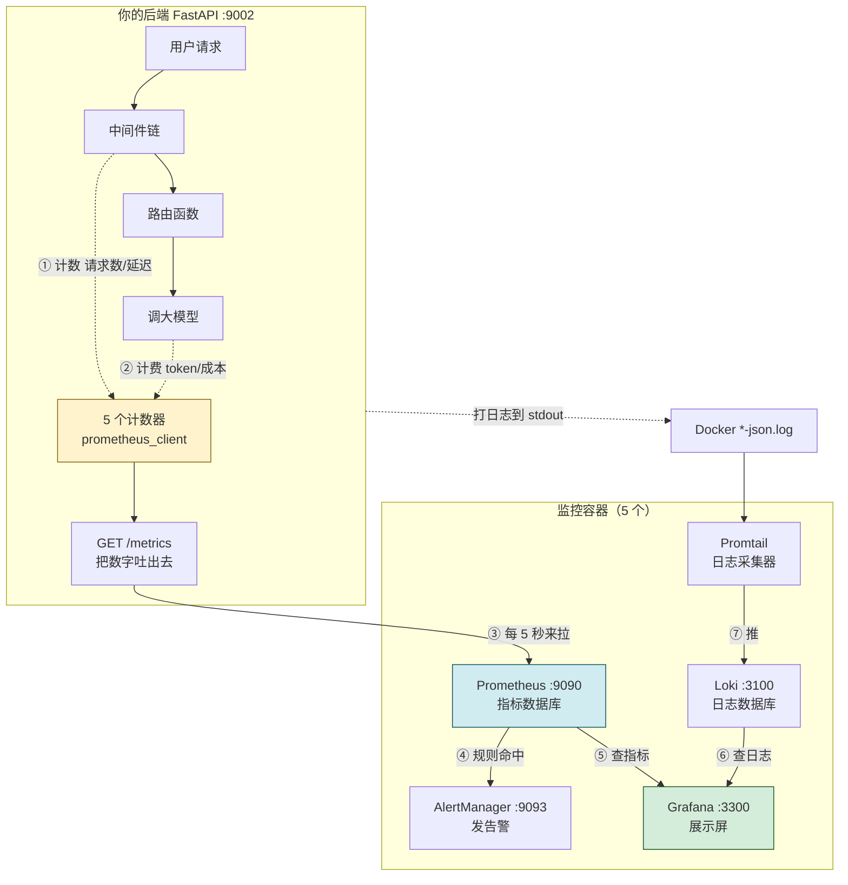
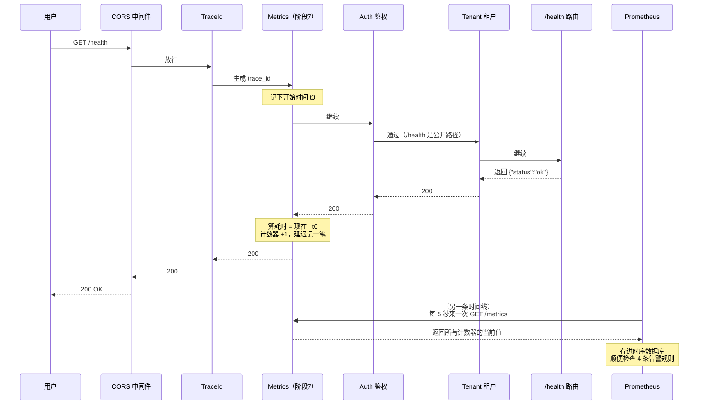

# AI 私厨 v3.0 · 阶段 7 理解手册
## —— 全栈监控到底是怎么跑起来的（大白话 + 图）

> **这份文档是给"知道阶段 7 做完了、但还不清楚到底做了什么"的你写的。**
> 不讲怎么敲命令（那是《操作手册》的事），也不逐行讲代码（那是《说明手册》的事）。
> 这份只回答三件事：**改了什么、怎么跑起来的、各部分怎么串在一起**。
>
> 阅读方式：先看第 1、2 章建立画面感，再看第 5 章的联动图，其余按需查。

---

## 目录

- [1. 一分钟版：阶段 7 到底干了什么](#1-一分钟版阶段-7-到底干了什么)
- [2. 全景图：数据是怎么流动的](#2-全景图数据是怎么流动的)
- [3. 改了哪些文件（一张清单）](#3-改了哪些文件一张清单)
- [4. 代码是怎么实现"可观测"的（七步走）](#4-代码是怎么实现可观测的七步走)
- [5. 目录之间怎么联动（重点章）](#5-目录之间怎么联动重点章)
- [6. 阶段 7 的完整操作流程（七步）](#6-阶段-7-的完整操作流程七步)
- [7. 一次请求的完整旅程（时序图）](#7-一次请求的完整旅程时序图)
- [8. 最容易搞混的 8 个问题](#8-最容易搞混的-8-个问题)
- [9. 面试时怎么讲这 30 秒](#9-面试时怎么讲这-30-秒)

---

## 1. 一分钟版：阶段 7 到底干了什么

### 一句话

**在原来那个"黑盒"系统里装上了仪表盘和警报器**——以后系统出问题，不用猜、不用翻日志，看屏幕就知道。

### 用开车来打比方

你的 AI 私厨项目原来就像一辆**没有仪表盘的车**：

| | 装仪表盘前（阶段 6 及以前） | 装仪表盘后（阶段 7） |
|---|---|---|
| 车速多快？ | 不知道 | **仪表盘显示 QPS**（每秒多少请求） |
| 开得稳不稳？ | 不知道 | **显示延迟 P99**（99% 的请求多久返回） |
| 出问题了吗？ | 用户投诉才知道 | **错误率曲线 + 自动告警** |
| 烧了多少钱？ | 月底看账单吓一跳 | **实时显示 LLM 花了多少钱** |
| 出事后查什么？ | `docker logs` 一屏屏翻 | **Grafana 里按 trace_id 搜日志** |

### 阶段 7 做了三件事（就这三件）

```text
① 埋点  →  ② 收集  →  ③ 展示 + 告警
 在代码里       用专门的工具      用 Grafana 画成图，
 放"计数器"     把数字存起来      超阈值就自动报警
```

- **① 埋点**：在后端代码里加了 5 个"计数器"（请求数、延迟、token 数、成本、配额使用率）
- **② 收集**：起了 5 个 Docker 容器专门干这事（Prometheus 存指标、Loki 存日志、Promtail 搬日志）
- **③ 展示 + 告警**：Grafana 画 4 块仪表盘，AlertManager 在指标异常时发告警

---

## 2. 全景图：数据是怎么流动的

### 2.1 最重要的一张图

```text
┌─────────────────────────────────────────────────────────────────┐
│                        你的 AI 私厨后端                          │
│                      （FastAPI，跑在 :9002）                     │
│                                                                 │
│   用户请求进来 ──► 中间件链 ──► 路由函数 ──► 调大模型              │
│                      │                          │               │
│                      │ ① 计数（+1）              │ ② 计费         │
│                      ▼                          ▼               │
│              ┌───────────────┐          ┌──────────────┐        │
│              │ 埋点 1、2、5   │          │ 埋点 3、4     │        │
│              │ 请求数/延迟/配额│          │ token 数/成本 │        │
│              └───────┬───────┘          └──────┬───────┘        │
│                      │                         │                │
│                      └──────────┬──────────────┘                │
│                                 ▼                               │
│                    内存里的 5 个"计数器"                          │
│                    （prometheus_client 维护）                    │
│                                 │                               │
│                  ③ 有人来问就把数字吐出去                         │
│                     GET /metrics  ◄──────────────────┐          │
└─────────────────────────────────┼───────────────────┴──────────┘
                                  │                   ▲
                         ④ 每 5 秒来拉一次             │ ④
                                  │                   │
                    ┌─────────────▼──────────┐        │
                    │      Prometheus :9090   │        │
                    │   （指标数据库，存历史）  │        │
                    └───────────┬────────────┘        │
                                │                     │
              ⑤ 规则命中？      │ ⑥ Grafana 来查数据   │
                                ▼                     │
                    ┌───────────────────────┐         │
                    │  AlertManager :9093   │         │
                    │   （发告警通知）        │         │
                    └───────────────────────┘         │
                                                      │
                    ┌───────────────────────┐         │
                    │    Grafana :3300      │─────────┘
                    │  （你眼睛看到的屏幕）   │
                    └───────────┬───────────┘
                                │ ⑦ 还要看日志
                                ▼
                    ┌───────────────────────┐
                    │      Loki :3100       │
                    │   （日志数据库）        │
                    └───────────▲───────────┘
                                │ 推
                    ┌───────────┴───────────┐
                    │      Promtail         │
                    │  （盯 Docker 日志文件） │
                    └───────────▲───────────┘
                                │ 读
                    ┌───────────┴───────────────────┐
                    │ /var/lib/docker/.../*-json.log │
                    │  （后端打的日志都在这里）        │
                    └───────────────────────────────┘
```

### 2.2 这张图里最关键的一个认知

**数据有两条完全独立的路**，很多新手会搞混：

| | 指标（Metrics） | 日志（Logs） |
|---|---|---|
| 是什么 | **数字**（请求数 127、延迟 0.3 秒） | **文本**（"用户登录失败"） |
| 谁主动 | **Prometheus 主动来拉**（每 5 秒） | **Promtail 主动推给 Loki** |
| 存在哪 | Prometheus | Loki |
| 用什么查 | PromQL（如 `rate(http_requests_total[1m])`） | LogQL（如 `{job="docker"} |= "ERROR"`） |
| 回答什么问题 | "有多少、多快、多少钱" | "具体发生了什么事" |

> 🟡 **记住这个对比**：指标是**拉**（pull），日志是**推**（push）。方向刚好相反。

### 2.3 Mermaid 版（如果你的编辑器支持图表渲染）



---

## 3. 改了哪些文件（一张清单）

阶段 7 一共动了 **21 个文件**：新建 15 个、修改 6 个。

### 3.1 新建的 15 个

| 文件 | 属于哪一类 | 一句话：它是干嘛的 |
|---|---|---|
| `app_my/core/metrics.py` | 🔴 核心代码 | **定义 5 个计数器**（要统计哪些东西就在这里声明） |
| `app_my/middleware/metrics.py` | 🔴 核心代码 | **自动计数 + 提供 /metrics 端点**（请求进来就 +1） |
| `docker/prometheus/prometheus.yml` | 配置 | 告诉 Prometheus "去哪拉、多久拉一次" |
| `docker/prometheus/alerts.yml` | 配置 | **4 条告警规则**（什么情况算异常） |
| `docker/alertmanager/alertmanager.yml` | 配置 | 告警来了怎么发、发给谁、怎么去重 |
| `docker/loki/loki-config.yaml` | 配置 | Loki 把日志存哪、存多久 |
| `docker/promtail/promtail-config.yaml` | 配置 | Promtail 去哪读日志、怎么打标签 |
| `docker/grafana/provisioning/datasources/datasources.yml` | 配置 | 让 Grafana 启动时**自动**连上 Prometheus 和 Loki |
| `docker/grafana/provisioning/dashboards/dashboards.yml` | 配置 | 让 Grafana **自动**加载仪表盘（不用手动导入） |
| `docker/grafana/dashboards/http-overview.json` | 仪表盘 | 第 1 块屏：QPS / 延迟 / 错误率 |
| `docker/grafana/dashboards/token-cost.json` | 仪表盘 | 第 2 块屏：LLM 花了多少钱 |
| `docker/grafana/dashboards/error-logs.json` | 仪表盘 | 第 3 块屏：错误日志（从 Loki 查） |
| `docker/grafana/dashboards/alerts.json` | 仪表盘 | 第 4 块屏：当前有哪些告警在响 |
| `tests/unit/test_metrics.py` | 测试 | 8 个单测，守着埋点逻辑 |
| `scripts/verify_stage7.py` | 验证脚本 | 一条命令跑完 11 项端到端检查 |

### 3.2 修改的 6 个

| 文件 | 改了什么 | 为什么必须改 |
|---|---|---|
| `main.py` | 加一行 `app.add_middleware(MetricsMiddleware)` | 不加，中间件不生效，`/metrics` 不存在 |
| `app_my/core/token_billing.py` | `record()` 末尾加一段上报 | token 和成本只有这里知道，必须在这里埋 |
| `app_my/middleware/quota.py` | 加一段上报配额使用率 | 配额告警需要这个数字 |
| `app_my/core/config.py` | 加 `PROMETHEUS_METRICS_PATH` 等 3 个配置 | 路径写成可配置的，不写死 |
| `pyproject.toml` | 加依赖 `prometheus-client` | 没这个库，代码跑不起来 |
| `docker/docker-compose.v3.yml` | 加 5 个服务的定义 | 容器得有人定义才会被创建 |

> 🟡 **只有前 3 个是"动了业务逻辑"的**，其余都是配置和依赖。
> 这也是阶段 7 的一个设计原则：**监控是旁路，尽量不侵入业务代码**。

---

## 4. 代码是怎么实现"可观测"的（七步走）

### 第 1 步：先声明"要统计什么" —— `metrics.py`

就像你要统计超市流水，得先决定统计哪些项。`metrics.py` 里定义了 **5 个计数器**：

| 编号 | 计数器名字 | 类型 | 通俗解释 |
|---|---|---|---|
| ① | `http_requests_total` | Counter（只增不减） | 一共来了多少个请求 |
| ② | `http_request_duration_seconds` | Histogram（分桶） | 每个请求花了多久 |
| ③ | `llm_tokens_total` | Counter | 大模型用了多少 token |
| ④ | `llm_cost_cny_total` | Counter | 大模型花了多少**元** |
| ⑤ | `llm_quota_used_ratio` | Gauge（可增可减） | 租户配额用了百分之几 |

**为什么 ①② 要带"标签"？**

```text
http_requests_total{method="GET", status="2xx", tenant_id="3", path="/health"}  127
                     ↑            ↑             ↑              ↑                ↑
                   什么方法     成功/失败      哪个租户        哪个接口       累计次数
```

有了标签，Grafana 里就能**按租户拆开看**："租户 3 的错误率是不是特别高？"——一眼看出来。
没有标签就只有一个总数，什么也拆不了。

> 🔴 **有个坑叫"高基数"**：如果 `path` 用真实 URL（`/users/123`、`/users/456`），
> 一百万个用户就产生一百万个标签组合，Prometheus 会被撑爆。
> 所以代码里用的是**路由模板** `/users/{user_id}`，基数永远只有几十个。

### 第 2 步：请求进来时自动 +1 —— `middleware/metrics.py`

你不用在每个接口里手写"计数器 +1"。**中间件**帮你做了：

```python
async def dispatch(self, request, call_next):
    path = request.url.path

    # 如果是 /metrics 自己，直接把数字吐出去，不计数（否则自己拉自己会无限增长）
    if path == settings.PROMETHEUS_METRICS_PATH:
        return PlainTextResponse(_build_metrics_text(), media_type=CONTENT_TYPE_LATEST)

    start = time.perf_counter()          # 计时开始
    response = await call_next(request)  # 让请求继续往下走（真正处理业务）
    cost_ms = (time.perf_counter() - start) * 1000   # 计时结束

    # 记录：请求数 +1，延迟记一笔
    _handle_inc(request, path_label, response.status_code, cost_ms)
    return response
```

**中间件是什么？** 就像小区门禁——所有人进出都要经过它，所以在门口装个计数器，
就能统计所有进出的人，不用挨家挨户去数。

### 第 3 步：大模型花钱时记账 —— `token_billing.py`

每次调大模型，阶段 2 就有的 `record()` 函数会记一笔账。阶段 7 在它末尾**追加**了一段：

```python
# ③ 阶段 7：metrics 上报（不影响原记账逻辑；失败则吞掉）
try:
    from app_my.core.metrics import tokens_inc, cost_inc
    if ok:
        tokens_inc(model, "input", int(input_tokens or 0))    # input token +N
        tokens_inc(model, "output", int(output_tokens or 0))  # output token +N
        cost = estimate_cost_cny(...)                          # 算这笔多少钱
        if cost is not None:
            cost_inc(model, cost)                              # 成本 +N 元
except Exception:
    pass
```

🔴 **为什么包在 `try...except: pass` 里？**
这是可观测的铁律：**监控出问题，绝不能让业务挂掉**。
宁可少记一条指标，也不能因为埋点报错导致用户聊不了天。

### 第 4 步：把数字吐出去 —— `/metrics` 端点

计数器都在内存里。Prometheus 来问的时候，后端把它渲染成一段**纯文本**：

```text
# HELP http_requests_total HTTP 请求总数
# TYPE http_requests_total counter
http_requests_total{method="GET",path="/health",status="2xx",tenant_id="anon"} 127.0
http_requests_total{method="POST",path="/chat/stream",status="2xx",tenant_id="3"} 12.0

# HELP llm_cost_cny_total LLM 调用成本累计（元）
llm_cost_cny_total{model="qwen-plus"} 3.4721
```

你可以自己打开浏览器看：`http://127.0.0.1:9002/metrics`

> 🟡 **这个端点不是"路由"**，而是写在中间件里的一个 if 判断。
> 这就是为什么它必须挂在**鉴权中间件之外**——否则 Prometheus 会被 401 挡在外面（本项目真踩过）。

### 第 5 步：Prometheus 每 5 秒来拉一次

`docker/prometheus/prometheus.yml` 里写死了：

```yaml
scrape_configs:
  - job_name: ai_chief_backend
    scrape_interval: 5s        # 每 5 秒
    static_configs:
      - targets: ["host.docker.internal:9002"]   # 去后端 9002 端口的 /metrics 拉
```

**为什么要"拉"而不是后端"推"？**
因为 Prometheus 拉的时候，能顺带记下"这次拉取成功了吗、花了多久"——**被监控对象挂了，Prometheus 立刻知道**。
如果是后端主动推，后端一挂就再没有数据上来，Prometheus 分不清"挂了"还是"没流量"。

### 第 6 步：Grafana 把数字画成图

Grafana 本身**不存数据**，它只是一个"画图的屏"，需要时去问 Prometheus / Loki。

你写的 4 个仪表盘 JSON 里，核心就是一句查询（PromQL）：

```promql
sum by (path) (rate(http_requests_total[1m]))
│   │          │    │                    │
│   │          │    │                    └─ 看最近 1 分钟
│   │          │    └─ 计数器名字
│   │          └─ rate = 算"每秒增长多少"（计数器是累加的，要看速率）
│   └─ 按接口拆开
└─ 求和
```

**为什么要用 `rate()`？** 因为计数器是**只增不减**的累加值（127 → 128 → 129...），
直接画出来是一条永远向上的斜线，看不出快慢。`rate()` 把它换算成"每秒增加多少"，才有意义。

### 第 7 步：指标异常就告警

`alerts.yml` 里写了 4 条规则：

| 规则名 | 人话 | 表达式 |
|---|---|---|
| `HighErrorRate` | 5xx 错误率超过 5%，持续 2 分钟 | `5xx速率 / 总速率 > 0.05` |
| `HighP99Latency` | 99% 的请求超过 3 秒 | `histogram_quantile(0.99, ...) > 3` |
| `TokenCostSpike` | 一小时成本是上周同期的 3 倍 | `成本速率 > 3 × 上周同期` |
| `QuotaExhausted` | 租户配额用到 90% 以上 | `llm_quota_used_ratio > 0.9` |

流程是：**Prometheus 判断"规则命中了" → 通知 AlertManager → AlertManager 去重、分组、发通知**。

> 🟡 为什么要分两步（Prometheus 判断、AlertManager 发送）？
> 因为"判断"和"通知"是两件事。AlertManager 负责**去重**（同一问题别发 100 条）
> 和**静默**（半夜不想被吵）。这个分工叫"关注点分离"。

---

## 5. 目录之间怎么联动（重点章）

这是你问的"不同目录下的代码是如何联动其他东西的"。

### 5.1 联动全景图

```text
┌────────────────────────────────────────────────────────────────────┐
│                     F:\pycharm_aiprogram\ai_chief\                   │
└────────────────────────────────────────────────────────────────────┘
        │                │                │               │
        ▼                ▼                ▼               ▼
   ┌─────────┐    ┌────────────┐   ┌──────────┐   ┌────────────┐
   │docker/  │    │ app_my/    │   │ tests/   │   │ scripts/   │
   │配置与容器│    │ 后端源码    │   │ 单元测试  │   │ 验证脚本    │
   └────┬────┘    └─────┬──────┘   └────┬─────┘   └─────┬──────┘
        │               │               │                │
        │               │               │                │
   ①容器定义         ②埋点代码       ③测试这些代码     ④端到端检查
        │               │               │                │
        └───────────────┴───────────────┴────────────────┘
                        │
                        ▼
              ┌──────────────────┐
              │  实际跑起来的系统   │
              │  5 容器 + 后端     │
              └──────────────────┘
```

### 5.2 四层之间具体怎么串（六条连线）

```text
① docker/docker-compose.v3.yml
   └─► 定义 5 个容器，并把 docker/prometheus/*.yml 挂进容器
        │
        │  挂载（volume）
        ▼
   docker/prometheus/prometheus.yml  ──►  告诉 Prometheus 去 host.docker.internal:9002 拉
        │                                              │
        │  引用                                        │ 拉取
        ▼                                              ▼
   docker/prometheus/alerts.yml              app_my/middleware/metrics.py
   （4 条告警规则）                            （提供 /metrics 端点）◄───┐
                                                       │              │
                                              http_inc() 调用          │
                                                       │              │
                                                       ▼              │
                                             app_my/core/metrics.py ──┘
                                             （定义 5 个计数器）

② app_my/core/metrics.py  ◄──被三处调用──
     ├─ app_my/middleware/metrics.py   （HTTP 请求数、延迟）
     ├─ app_my/core/token_billing.py   （token 数、成本）
     └─ app_my/middleware/quota.py     （配额使用率）

③ main.py  ──►  app.add_middleware(MetricsMiddleware)
   （顺序必须是：在 AuthMiddleware 之后 add，这样 Metrics 才在更外层）

④ tests/unit/test_metrics.py  ──►  直接 import app_my.core.metrics
   （测试计数器是否真的会 +1、标签对不对、/metrics 端点返回 200）

⑤ scripts/verify_stage7.py  ──►  同时检查：
     ├─ 5 个容器是不是 Up        （问 Docker）
     ├─ /metrics 有没有 5 个指标  （问后端 :9002）
     └─ Prometheus 有没有抓到后端 （问 Prometheus :9090）

⑥ docker/grafana/provisioning/datasources/datasources.yml
   └─► 给数据源起了固定的 uid："prometheus" 和 "loki"
        │
        │  必须一致！
        ▼
   docker/grafana/dashboards/*.json
   └─► 每个面板里写死 "uid": "prometheus"
```

### 5.3 一个具体例子：改一处会牵动哪些文件？

**场景**：你想新增一个指标"缓存命中率"。

| 步骤 | 要改哪个文件 | 联动影响 |
|---|---|---|
| 1 | `app_my/core/metrics.py` 加一个 Gauge | 无（只是多定义一个） |
| 2 | `app_my/api/cache.py` 里调用它 | 阶段 5 的缓存代码要动一行 |
| 3 | `docker/grafana/dashboards/*.json` 加个面板 | 面板里的 `uid` 必须是 `"prometheus"` |
| 4 | （可选）`docker/prometheus/alerts.yml` 加告警 | 改完要 `restart prometheus` |
| 5 | （可选）`tests/unit/test_metrics.py` 加测试 | pytest 数量从 91 变成 92 |

> 🟡 看出来了吗：**`metrics.py` 是唯一的"定义中心"**，所有地方都从它 import。
> 所以加指标只需要在一个地方定义，别处引用即可——这就是"单一职责"。

### 5.4 另一个例子：Grafana 面板为什么全白？（uid 的连锁反应）

```text
datasources.yml 里没写 uid
        │
        ▼
Grafana 自己生成一个随机 uid（比如 "a1b2c3"）
        │
        ▼
仪表盘 JSON 里写死 "uid": "prometheus"
        │
        ▼
对不上  ──►  每个面板都报 "Datasource not found"
        │
        ▼
表现：4 块仪表盘全空白，而且不报任何明显错误
```

**这是一个"两个目录下的文件必须保持一致"的典型例子**：
`docker/grafana/provisioning/` 和 `docker/grafana/dashboards/` 是两个目录，
但通过 `uid` 这个字符串**隐式耦合**在一起。改一个忘了另一个，就会静默失败。

---

## 6. 阶段 7 的完整操作流程（七步）

```text
第 1 步                第 2 步              第 3 步
切分支             ──►  拉镜像        ──►  写 6 个配置文件
git checkout -b        docker pull        docker/prometheus/*.yml
feat/v3-stage7         (5 个)             docker/loki/*.yaml 等
                                          🔴 必须先写配置！

     │
     ▼
第 4 步              第 5 步             第 6 步
起 5 个容器      ──►  写后端埋点代码  ──►  重启后端 + 验证
docker compose        metrics.py          GET /metrics 能看到数字
up -d                 middleware/
                      token_billing 改造

     │
     ▼
第 7 步
跑测试 + 验证脚本 + 提交
pytest (91 passed)
verify_stage7.py (11/11)
git commit → PR
```

### 每一步在做什么、为什么

| 步 | 做什么 | 🔴 关键注意点 |
|---|---|---|
| 1 | 切分支 `feat/v3-stage7` | 确认阶段 6 的 PR 已合并到 master |
| 2 | 拉 5 个镜像 | 本机镜像源有坑，拉不动要换源 |
| 3 | **写 6 个配置文件** | 🔴 **必须早于起容器**！否则 Docker 会自动建目录顶替，报 `not a directory` |
| 4 | 起容器 | `rm -sf` 删旧容器再 `up -d`（旧容器会缓存错误的挂载类型） |
| 5 | 写后端埋点代码 | `MetricsMiddleware` 必须挂在 `AuthMiddleware` **之后** add |
| 6 | 重启后端 + 验证 | 用 `Start-Process`（PowerShell 不支持 `nohup`） |
| 7 | 跑测试 + 验证 + 提交 | 🔴 `.gitignore` 没忽略 `.venv3`，别 `git add .` |

> 🔴 **最容易翻车的就是第 3 步和第 4 步的顺序**。
> 这不是代码问题，是**操作顺序问题**——但报错信息（`not a directory`）看起来像是代码写错了，
> 会让新手在那儿查半天配置。

---

## 7. 一次请求的完整旅程（时序图）

用户访问 `GET /health` 时，系统里发生了什么：



**关键点**：

1. **埋点发生在"响应返回之后"**（`await call_next()` 之后）——因为那时候才知道状态码和耗时。
2. **Metrics 在 Auth 外层**，所以被 401 拒绝的请求**也会**被记进错误率（这是故意的）。
3. **Prometheus 的拉取是另一条独立时间线**，跟用户请求没关系，它每 5 秒自己来一次。

---

## 8. 最容易搞混的 8 个问题

### Q1：`/metrics` 是个接口吗？为什么我在 `app_my/api/` 里找不到它？

**不是路由**。它是写在 `MetricsMiddleware.dispatch()` 里的一个 if 判断：

```python
if path == "/metrics":
    return PlainTextResponse(_build_metrics_text(), ...)
```

所以在 `api/` 目录下找不到任何文件——这就是为什么它很容易被漏掉，也容易被鉴权拦住。

### Q2：为什么中间件顺序是"倒着写"的？

FastAPI 的规则：**`add_middleware()` 后注册的更靠外层**。所以代码里从里往外写：

```text
代码书写顺序（从上到下）          实际执行顺序（从外到内）
─────────────────────          ─────────────────────
add_middleware(Quota)      →      CORS
add_middleware(RateLimit)  →      TraceId
add_middleware(Tenant)     →      Metrics      ← 阶段 7
add_middleware(Auth)       →      Auth
add_middleware(Metrics)    →      Tenant
add_middleware(TraceId)    →      RateLimit
add_middleware(CORS)       →      Quota
```

### Q3：Metrics 为什么不在最外层（CORS 之外）？

浏览器发跨域请求时会先发一个 OPTIONS 预检。如果 Metrics 在最外层，
预检 + 真实请求会被**记两次**，指标虚高一倍。

### Q4：Metrics 为什么又在 Auth 之外？

被 401 拒绝的请求也要计入错误率——否则错误率面板永远看不到鉴权失败，
**监控就瞎了一只眼**。

### Q5：Prometheus 和 Loki 都是"数据库"，能合并成一个吗？

不能，因为它们存的**东西本质不同**：

| | Prometheus | Loki |
|---|---|---|
| 存什么 | 数字（时间序列） | 文本（日志行） |
| 索引什么 | 全部标签 | **只索引标签，不索引正文** |
| 查询语言 | PromQL | LogQL |
| 回答什么 | "多少 / 多快" | "发生了什么" |

Loki 那个"只索引标签"的设计是它省资源的关键——日志正文不建索引，用 gzip 压了直接存。

### Q6：计数器一直是累加的，怎么看出"当前 QPS"？

用 `rate()` 函数换算成速率。这就是仪表盘里每个查询都带 `rate(...)` 的原因。

```promql
rate(http_requests_total[1m])     # 最近 1 分钟，平均每秒增加多少
```

### Q7：为什么告警要"Prometheus 判断 + AlertManager 发送"两步？

分工不同：

- **Prometheus** 负责"**是不是出问题了**"（算规则）
- **AlertManager** 负责"**要不要打扰人**"（去重、分组、静默、选择发到哪）

如果一个服务挂了，可能同时触发 20 条规则。AlertManager 会把它们**合并成一条通知**，
不然你的手机会被轰炸。

### Q8：阶段 7 埋的这些点，后面阶段还用得上吗？

用得上，而且是**硬依赖**：

- **阶段 8（Celery + WebSocket）**：Celery worker 要暴露自己的指标端口（`WORKER_METRICS_PORT=9101`），
  复用阶段 7 的 Prometheus；任务堆积、推送失败都要靠这里的告警发现。
- **阶段 9（微服务拆分 + Kong）**：拆分前后要对比指标，证明"拆分确实带来了收益"——
  没有阶段 7 的基线数据，拆完你无法证明任何事。

> 🟡 这也解释了为什么阶段 7 必须排在阶段 8、9 前面：**先有观测手段，才有后面的改造依据**。

---

## 9. 面试时怎么讲这 30 秒

> "我给项目做了全栈可观测。**埋点层**用 prometheus_client 在中间件里手工埋了 5 个指标
> （QPS、延迟、token 消耗、成本、配额使用率），带 tenant_id 标签，所以能按租户下钻；
> **收集层**用 Prometheus 拉指标、Loki + Promtail 收日志；
> **展示层**用 Grafana 配了 4 块仪表盘，用 provisioning 自动加载，不用手动导入；
> **告警层**用 AlertManager 配了 4 条规则，并且**真的制造 5xx 触发过一次**，验证链路是通的。
> 整套是旁路设计，埋点全部包了 try/except，**监控挂了不影响业务**。"

**如果面试官追问"为什么要手工埋点而不是用现成的 instrumentator"**：

> "因为自动埋点拿不到 tenant_id 这种业务标签。我们是多租户 SaaS，
> 必须能按租户拆开看错误率和成本——这是自动埋点给不了的。"

---

## 附：一页纸速查

```text
阶段 7 三件事：埋点 → 收集 → 展示+告警

5 个容器：Prometheus 9090 / Grafana 3300 / AlertManager 9093 / Loki 3100 / Promtail(无端口)
5 个指标：http_requests_total / http_request_duration_seconds /
          llm_tokens_total / llm_cost_cny_total / llm_quota_used_ratio
4 条告警：HighErrorRate / HighP99Latency / TokenCostSpike / QuotaExhausted
4 块屏  ：http-overview / token-cost / error-logs / alerts

核心代码（只有 2 个新文件）：
  app_my/core/metrics.py          定义 5 个计数器
  app_my/middleware/metrics.py    自动计数 + 提供 /metrics

验收基线：pytest 91 passed（+8）、verify_stage7.py 11/11

三个必记的坑：
  1. 先写配置文件，再起容器（反过来报 not a directory）
  2. MetricsMiddleware 必须在 AuthMiddleware 之后 add（否则 /metrics 401）
  3. datasources.yml 的 uid 必须和仪表盘 JSON 里的 uid 一致（否则面板全白）
```
