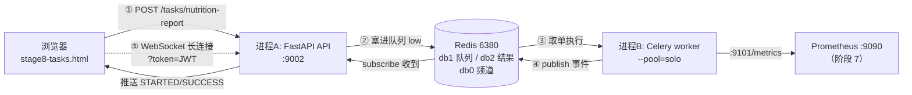
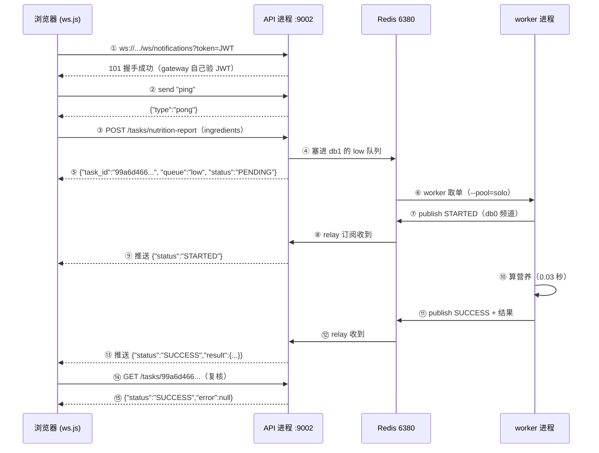

# AI 私厨 v3.0 阶段 8 理解手册 — 大白话与图解
### Celery 异步任务队列 + WebSocket 实时推送

> **这份文档是给"看不懂阶段 8 到底在干什么"的人写的。**
> 它**不讲**每一行代码怎么写（那是《操作手册》的事），也**不逐行翻译**代码（那是《说明手册》的事）。
> 它只回答三个问题：**这阶段干了什么？为什么要这么干？这些零件是怎么连起来的？**
>
> 配套文档：
> - 想**照着敲** → 《AI私厨_v3.0_阶段8_Celery异步任务与WebSocket推送_操作手册.md》
> - 想**看懂每行为什么这么写** → 《AI私厨_v3.0_阶段8_..._说明手册.md》
> - 想**收官全貌 + 问题复盘** → 《AI私厨_v3.0_阶段8_最终完整版.md》 / 《AI私厨_v3.0_阶段8_问题与解决记录.md》

---

## 目录

- [一、一分钟版：三句话说完](#一一分钟版三句话说完)
- [二、全景图：两个进程 + 一个 Redis + 一个浏览器](#二全景图两个进程--一个-redis--一个浏览器)
- [三、文件清单：新建了什么、改了什么](#三文件清单新建了什么改了什么)
- [四、代码是怎么实现目标的（七步走）](#四代码是怎么实现目标的七步走)
- [五、目录联动图：这些文件夹之间怎么连线](#五目录联动图这些文件夹之间怎么连线)
- [六、操作流程：三个终端怎么配合](#六操作流程三个终端怎么配合)
- [七、时序图：一份营养报告的完整旅程](#七时序图一份营养报告的完整旅程)
- [八、最容易卡住的 10 个问题](#八最容易卡住的-10-个问题)
- [九、面试话术与一页纸速查](#九面试话术与一页纸速查)

---

## 一、一分钟版：三句话说完

**第一句（问题）**：以前所有活都在"接电话的那个进程"里干完——用户点一下"生成营养报告"，后端就要当场算完才返回；算 8 秒，浏览器就转 8 秒圈，中间用户什么都看不到，还可能超时断线。

**第二句（做法）**：阶段 8 把"接活"和"干活"拆成**两个进程**：
- **API 进程**（9002 端口）：只负责收下请求、回一句"收到了，编号 xxx"，然后立刻返回；
- **worker 进程**（Celery）：从 Redis 里把活取出来慢慢干，干完把结果和状态发到 Redis 频道；
- **WebSocket**：API 进程收到 Redis 的通知，顺着那条**一直连着浏览器的长连接**把"干完了"推回去。

**第三句（验收）**：实测三条都成立——`pytest` **118 passed**（阶段 7 的 91 + 本阶段新增 27）、分级路由 `high/default/low` 各落 1 条、端到端 WebSocket 收到 `STARTED → SUCCESS` 两个推送。

### 1.1 一个生活比喻（先记住这个，后面全是它的展开）

把系统想成**一家餐厅**：

| 餐厅里 | 系统里 | 一句话 |
|---|---|---|
| 顾客点单 | 浏览器发 `POST /tasks/nutrition-report` | "我要一份营养报告" |
| 服务员写小票、报单号 | API 进程写一条 Celery 任务消息进 Redis | "拿到了，编号 99a6d4…" |
| 出单口夹着的一叠小票 | Redis db1 里的三个队列（high/default/low） | 单子排队，谁急谁先 |
| 后厨按小票做菜 | worker 进程取单执行 | 慢慢做，做多久前台不管 |
| 做好了按铃 | worker 往 Redis 频道 `ai_chief:ws:notify` 发一条事件 | "编号 99a6d4 好了" |
| 服务员听到铃、端菜上桌 | relay 中继收到事件 → 通过 WebSocket 推给浏览器 | 页面自己弹出结果 |

**一句话记住：前台（API）只管收单和传菜，后厨（worker）只管做菜，中间靠"出单口 + 铃"（Redis）传话。两边谁也不认识谁。**

### 1.2 为什么"不认识对方"反而更好

- **前台不会被拖死**：做菜 8 秒，前台早去接待下一个顾客了；
- **后厨崩了不丢单**：`task_acks_late=True`（干完才签收），崩了单子会重新回到队列；
- **可以多加几个后厨**：再开一个 worker 只消费 `low` 队列，前台代码一行都不用改；
- **急单能插队**：三条队列 = 三个优先级，运维重索引走 `high`，用户报告走 `low`，互不堵塞。

---

## 二、全景图：两个进程 + 一个 Redis + 一个浏览器

### 2.1 ASCII 全景图（任何编辑器都能看）

```
                        浏览器 (frontend/stage8-tasks.html)
                                    │
                     ① HTTP POST   │   ⑤ WebSocket 推送
                        (短连接)    │    (长连接 ws://...:9002/ws/notifications?token=)
                                    │
        ┌───────────────────────────┴───────────────────────────┐
        │                                                       │
        ▼                                                       ▼
┌───────────────────────────┐                        ┌──────────────────────┐
│  进程 A：API（FastAPI）    │                        │  浏览器里的 ws.js     │
│  端口 9002                 │                        │  （自动重连 + 心跳）  │
│                           │                        └──────────────────────┘
│  POST /tasks/*   ──┐      │
│  GET  /tasks/{id}  │      │
│  /ws/notifications │      │
│                    │      │
│  relay 中继协程 ◄──┼──────┼──── ④ subscribe 频道 ai_chief:ws:notify
└─────────┬──────────┴──────┘                              ▲
          │ ② 把任务消息塞进队列                              │ ③ publish 事件
          │   (celery_app.send_task)                        │
          ▼                                                 │
┌───────────────────────────────────────┐        ┌──────────┴──────────────┐
│  Redis 6380（复用阶段 1 的容器）        │        │  进程 B：worker          │
│   db0 = 限流/配额/缓存/JWT + WS 频道   │        │  celery -A ... worker    │
│   db1 = 任务队列 high/default/low      │───────▶│  --pool=solo             │
│   db2 = 任务结果（保留 1 小时）         │  取单   │  -Q high,default,low     │
└───────────────────────────────────────┘        │  指标 :9101/metrics      │
                                                 └─────────────────────────┘
                                                              │
                                                              │ 阶段 7 的 Prometheus
                                                              ▼
                                                    :9090 抓 ai_chief_worker
```

**一句话记住：API 进程和 worker 进程**只在 Redis 里碰面**，一个往队列里"塞"、一个从队列里"取"，一个往频道"发"、一个从频道"收"。**

### 2.2 Mermaid 版（支持渲染的客户端更好看）



### 2.3 图里最容易看错的三件事

1. **WebSocket 那条线是"长连接"，不是一次一断的 HTTP**。它建立后一直挂着，服务端随时可以往里塞消息——这是"实时推送"的物理基础。
2. **worker 和浏览器之间没有线**。worker 根本不知道浏览器存在，它只会往 Redis 频道喊一嗓子。真正把消息送到浏览器的是 API 进程里的 **relay 中继协程**。
3. **Redis 里分了三个 db**：db0 业务（限流/配额/缓存/JWT/WS 频道）、db1 任务队列、db2 任务结果。**永远别 `FLUSHALL`**，那会把限流计数和 JWT 黑名单一起清掉。

---

## 三、文件清单：新建了什么、改了什么

> 按 `git show --name-only HEAD`（提交 `7b5547c`，分支 `feat/v3-stage8`）实测整理。

### 3.1 🟢 新建（26 个）

| # | 文件 | 一句话作用 |
|---|---|---|
| 1 | `app_my/worker/__init__.py` | 让 `app_my/worker` 变成一个可导入的包 |
| 2 | `app_my/worker/celery_app.py` | **任务系统的大脑**：Celery 实例 + 三条队列 + 分级路由 |
| 3 | `app_my/worker/base.py` | 任务基类 `NotifyTask`：开始/成功/失败时自动发事件 + 打点 |
| 4 | `app_my/worker/signals.py` | worker 生命周期信号：起指标服务、定时刷队列深度 |
| 5 | `app_my/worker/tasks/__init__.py` | 任务包入口 |
| 6 | `app_my/worker/tasks/reindex.py` | 长任务①：Milvus 向量重索引（**high** 队列） |
| 7 | `app_my/worker/tasks/graph.py` | 长任务②：Neo4j 图谱重建（**default** 队列） |
| 8 | `app_my/worker/tasks/nutrition.py` | 长任务③：营养报告生成（**low** 队列） |
| 9 | `app_my/core/notify.py` | 跨进程通知：worker 把事件 publish 到 Redis 频道 |
| 10 | `app_my/core/worker_metrics.py` | worker 自己的 4 个 Prometheus 指标 + `:9101` 指标服务 |
| 11 | `app_my/schemas/tasks.py` | 任务接口的进出数据模型（Pydantic） |
| 12 | `app_my/api/tasks.py` | 三个提交接口 + 一个状态查询接口 |
| 13 | `app_my/ws/__init__.py` | WS 包入口 |
| 14 | `app_my/ws/manager.py` | 连接管理器：按租户分组存活着的连接 |
| 15 | `app_my/ws/gateway.py` | WS 网关 `/ws/notifications`：握手鉴权 + ping/pong |
| 16 | `app_my/ws/relay.py` | Redis 订阅中继：把 worker 的喊话转给本进程的连接 |
| 17 | `frontend/js/ws.js` | 浏览器端 WS 客户端：自动重连 + 心跳 + 事件回调 |
| 18 | `frontend/stage8-tasks.html` | 演示页：提交任务 + 实时看事件流 |
| 19 | `scripts/verify_stage8.py` | 验收脚本（routing / e2e 两种模式） |
| 20 | `scripts/check_stage8_routes.py` | 路由自检：5 个阶段 8 路由是否都挂上了 |
| 21 | `tests/unit/test_celery_app.py` | 6 例：Celery 配置 + 任务真的能算 |
| 22 | `tests/unit/test_notify.py` | 4 例：事件形状 + Redis 挂了不能拖垮任务 |
| 23 | `tests/unit/test_task_api.py` | 7 例：鉴权、队列分级、状态查询 |
| 24 | `tests/unit/test_ws_gateway.py` | 4 例：无 token / refresh token / 垃圾 token 全拒 |
| 25 | `tests/unit/test_ws_manager.py` | 6 例：租户隔离、死连接清理、重复断开 |
| 26 | `_verify_wsjs.js` | ⚠️ 临时脚本（Node 校验 ws.js 语法），本不该进仓库 |

### 3.2 🔵 修改（5 个）

| # | 文件 | 改了什么 |
|---|---|---|
| 1 | `app_my/core/config.py` | 加 6 个配置：broker / result backend / eager 开关 / 结果过期 / `WORKER_METRICS_PORT=9101` / `WS_NOTIFY_CHANNEL` |
| 2 | `main.py` | 加 `import asyncio`；引入 tasks 路由 + WS 网关；lifespan 里起/停 relay 协程 |
| 3 | `requirements.txt` | 登记 `celery` / `websockets` 等新增依赖 |
| 4 | `docker/prometheus/prometheus.yml` | 新增 job `ai_chief_worker`，抓 `host.docker.internal:9101` |
| 5 | `docker/prometheus/alerts.yml` | 新增 2 条告警（任务失败率、队列积压） |

### 3.3 一张"谁依赖谁"的小表

```
config.py  ──被──▶ celery_app.py / notify.py / relay.py / worker_metrics.py
celery_app.py ──被──▶ api/tasks.py（发任务） + worker/tasks/*（注册任务）
base.py    ──被──▶ worker/tasks/*（三个任务都继承它）
notify.py  ──被──▶ base.py（任务回调里 publish）
manager.py ──被──▶ gateway.py（注册连接） + relay.py（派发事件）
relay.py   ──被──▶ main.py（lifespan 里起协程）
```

---

## 四、代码是怎么实现目标的（七步走）

> 每一步都回答两件事：**这步做了什么** + **不做的后果**。

### 第 1 步：加 6 个配置（`app_my/core/config.py`）

| 配置 | 值 | 不写会怎样 |
|---|---|---|
| `CELERY_BROKER_URL` | `redis://localhost:6380/1` | Celery 默认去连 `amqp://localhost`（RabbitMQ），本机没装 → 启动即连不上 |
| `CELERY_RESULT_BACKEND` | `redis://localhost:6380/2` | 查不到任务结果，`GET /tasks/{id}` 永远返回 PENDING |
| `CELERY_TASK_ALWAYS_EAGER` | `False` | 单测里设 `True`，任务当场同步执行，不用起 worker |
| `CELERY_TASK_RESULT_EXPIRES` | `3600` | 结果永久堆在 Redis 里，内存慢慢撑爆 |
| `WORKER_METRICS_PORT` | `9101` | worker 没有指标端口，Prometheus 抓不到（告警就瞎了） |
| `WS_NOTIFY_CHANNEL` | `ai_chief:ws:notify` | worker 和 relay 各喊各的，永远对不上 |

**为什么 broker 用 db1、结果用 db2、通知走 db0**：db0 是阶段 4/5 传下来的业务库（限流、配额、缓存、JWT 黑名单），任务消息量大会把 key 冲乱，所以隔离出去；而通知频道必须在 **db0**，因为发布方（`notify.py` 用 `get_redis()`）和订阅方（`relay.py` 用 `settings.REDIS_URL`）读的是同一个 db —— **改成 db1 就永远收不到**，这是新手最容易撞的墙。

### 第 2 步：建 Celery 应用 + 三条队列（`app_my/worker/celery_app.py`）

一个文件干三件事：

1. **连上 Redis**：broker（db1）+ result backend（db2）+ `broker_connection_retry_on_startup=True`（Redis 还没醒时重试而不是崩）。
2. **声明三条队列**：`high` / `default` / `low`，并用 `task_routes` 把任务名映射到队列——这就是"任务分级"：
   - `tasks.reindex_milvus` → **high**（运维级，向量库重索引，最要紧）
   - `tasks.rebuild_kg_graph` → **default**（数据级，图谱重建）
   - `tasks.generate_nutrition_report` → **low**（用户级，繁但不急）
3. **声明 `imports`**：告诉 worker 启动时要加载哪些模块，**不写的话 worker 起来后"找不到任务"**（注册不上，报 `Received unregistered task`）。

另外三个可靠性开关（都是"不写就会踩坑"级别）：
- `task_acks_late=True`：干完才签收 → worker 中途崩了任务自动重投，不丢单；
- `worker_prefetch_multiplier=1`：一次只预取一条 → 长任务不会被一个 worker 全囤走；
- `task_track_started=True`：允许出现 `STARTED` 状态 → 否则你只能看到 `PENDING → SUCCESS`，永远不知道"它到底开跑没有"。

### 第 3 步：给任务加一个"会自动汇报"的基类（`app_my/worker/base.py`）

普通 Celery 任务跑完就完了，没人知道它什么时候开始、什么时候结束。阶段 8 定义了 `NotifyTask` 基类，在三个回调里各做两件事：

| 回调 | 发什么事件 | 打什么点 |
|---|---|---|
| `on_start` | `STARTED` | `task_started()` 计数 |
| `on_success` | `SUCCESS` + 结果 | `task_succeeded()` 计数 + 耗时直方图 |
| `on_failure` | `FAILURE` + 错误摘要 | `task_failed()` 计数 |

**一句话记住：基类就是给每个任务装了"三个自动汇报按钮"——开始按一下、成功按一下、失败按一下。**

### 第 4 步：worker 起自己的指标服务（`app_my/worker/signals.py`）

worker 是**独立进程**，`main.py` 里那个 `/metrics` 端点它根本没有。所以要用 Celery 的 `worker_ready` / `worker_init` 信号，在 worker 启动时：

1. 起一个 `start_http_server(9101)` —— 让 Prometheus 来抓 `celery_*` 指标；
2. 起一个后台循环，定时刷新三条队列的深度（`celery_queue_depth`）。

**为什么不复用阶段 7 的 multiprocess 模式**：本机 worker 用 `--pool=solo`（单进程），multiprocess 模式需要 `PROMETHEUS_MULTIPROC_DIR` 环境变量 + 文件收集，纯属多余复杂度。单进程直接 `start_http_server` 最省事。

### 第 5 步：跨进程喊话（`app_my/core/notify.py`）

worker 进程里**根本没有浏览器连接对象**（连接活在 FastAPI 进程的内存里），worker 唯一能碰到的公共设施就是 Redis。所以：

```text
worker ──publish──▶ Redis 频道 ai_chief:ws:notify ──subscribe──▶ FastAPI 进程 ──▶ 浏览器
```

两个刻意的设计：
- **事件字段固定**：`{type, task_id, name, status, result, error, tenant_id, user_id}`。前端拿到的 JSON 永远长这样，好解析。
- **失败绝不抛异常**：`publish_task_event` 里 `except Exception: return 0` 是**刻意**的，不是偷懒。Redis 抖一下就把任务标成 FAILURE，那是设计错误——通知只是锦上添花。

### 第 6 步：WebSocket 三件套（`app_my/ws/`）

| 文件 | 角色 | 一句话 |
|---|---|---|
| `manager.py` | 电话簿 | 按 `tenant_id` 分组保存活着的连接；派发时**只发给同一租户**，并顺手清掉死连接 |
| `gateway.py` | 门卫 | `/ws/notifications` 端点，**自己验 JWT**（见下面两个大坑）；支持 `ping → pong` 心跳 |
| `relay.py` | 传话筒 | 用 `redis.asyncio` 订阅频道，收到就交给 manager 派发；断线 3 秒重连，永不退出 |

**🔴 两个新手大坑（本阶段最容易翻车的地方）：**

1. **浏览器原生 WebSocket 不能带自定义 header**。`new WebSocket(url, {headers: {...}})` 是**无效**的——第二个参数只支持子协议字符串。所以令牌只能走 `?token=xxx` 查询参数（本阶段选这个），或者连上后首帧发 token。
2. **HTTP 中间件管不到 WebSocket**。那些 `add_middleware`（Auth / 限流 / 指标）只处理 `scope["type"] == "http"`；WS 的 scope 是 `"websocket"`，**会绕过所有中间件直达端点**。所以 `gateway.py` 必须自己调 `decode_token()` 校验——否则会出现"以为有中间件兜底、结果游客也能连"的安全洞。

### 第 7 步：接口 + 接线 + 可观测 + 前端

- **`app_my/api/tasks.py`**：三个提交接口（`POST /tasks/reindex-milvus`、`/rebuild-kg`、`/nutrition-report`）+ 一个查询接口（`GET /tasks/{task_id}`）。提交时从当前登录用户取 `tenant_id / user_id` 塞进任务参数——这样后面才知道"该推给谁"。
- **`main.py`**：加 `import asyncio`；`include_router` 注册 tasks 路由与 WS 网关；**lifespan 里 `asyncio.create_task(run_relay())` 必须在 `yield` 之前**，取消必须在 `yield` 之后（写反了服务一启动中继就死）。
- **`docker/prometheus/*.yml`**：新增 job `ai_chief_worker` 抓 `host.docker.internal:9101`（worker 跑在宿主机，容器里靠这个域名访问宿主机）+ 2 条新告警（任务失败率、队列积压）。
- **`frontend/`**：`js/ws.js` 负责自动重连 + 心跳 + 事件回调；`stage8-tasks.html` 是演示页，能提交任务并实时看到事件流。

---

## 五、目录联动图：这些文件夹之间怎么连线

### 5.1 ASCII 联动图

```
app_my/core/config.py  ──(环境变量/常量)──┐
        │                                 │
        ├──▶ worker/celery_app.py ──▶ Redis db1(队列) / db2(结果)
        ├──▶ core/notify.py ───────▶ Redis db0(频道 ai_chief:ws:notify)
        ├──▶ ws/relay.py ──────────▶ Redis db0(同一个频道，订阅方)
        └──▶ core/worker_metrics.py ─▶ :9101/metrics ──▶ Prometheus :9090

app_my/worker/base.py ──▶ core/notify.py（回调里 publish）
app_my/worker/tasks/*  ──▶ worker/base.py（继承 NotifyTask）
app_my/api/tasks.py    ──▶ worker/celery_app.py（delay 发任务 / AsyncResult 查状态）
app_my/ws/gateway.py   ──▶ ws/manager.py（注册/注销连接）
app_my/ws/relay.py     ──▶ ws/manager.py（dispatch 派发）
main.py                ──▶ ws/relay.py（lifespan 起协程）+ api/tasks.py + ws/gateway.py
frontend/js/ws.js      ──(ws:// 协议)──▶ app_my/ws/gateway.py
docker/prometheus/*.yml ──(HTTP 抓取)──▶ :9101（worker）/ :9002（API）
```

### 5.2 七条关键连线（每条都写清"靠什么耦合"）

| # | 连线 | 耦合方式 | 断了的症状 |
|---|---|---|---|
| 1 | `api/tasks.py` ↔ `worker/celery_app.py` | 同一个 Python 对象（`celery_app.send_task`）+ 同一个 Redis db1 | 提交成功但 worker 永远不执行 |
| 2 | `worker/base.py` ↔ `core/notify.py` | 直接函数调用（回调里 publish） | 任务跑完了浏览器没反应 |
| 3 | `core/notify.py` ↔ `ws/relay.py` | **同一个 Redis db + 同一个频道名**（必须都是 db0） | 同上，且最难查（两边都"没报错"） |
| 4 | `ws/relay.py` ↔ `ws/manager.py` | 内存里的全局单例 `manager` | 事件进来了但没人收到 |
| 5 | `main.py` ↔ `ws/relay.py` | lifespan 里的 `asyncio.create_task` | 服务起来了但推送永远不到 |
| 6 | `frontend/js/ws.js` ↔ `ws/gateway.py` | `ws://` 协议 + `?token=` 查询参数 | 控制台 `1008` / `1006` 握手失败 |
| 7 | `worker` ↔ Prometheus | HTTP `:9101/metrics`（容器访问用 `host.docker.internal`） | `ai_chief_worker` 一直 `down` |

**一句话记住：3 号连线（发布方和订阅方必须在同一个 Redis db）是全链路最脆的一环，因为它断了以后两边都不报错。**

---

## 六、操作流程：三个终端怎么配合

| 终端 | 干什么 | 关键命令（PowerShell） |
|---|---|---|
| **A** | 起 API 进程 | `& ".\.venv3\Scripts\python.exe" -m uvicorn main:app --host 127.0.0.1 --port 9002` |
| **B** | 起 worker 进程 | `& ".\.venv3\Scripts\python.exe" -m celery -A app_my.worker.celery_app:celery_app worker --loglevel=info --pool=solo -Q high,default,low -n stage8@%h` |
| **C** | 跑验证 / 测试 | `.\.venv3\Scripts\python.exe scripts\verify_stage8.py e2e` |

### 6.1 顺序与致命注意点

1. **先确认容器在跑**（Redis 6380 / PG 5433 / Milvus / Neo4j 都 `Up`）——缺一个后面报的错都看不懂。
2. **先起 A 再起 B**：API 先起来才能接 WebSocket；worker 后起来不会漏任务（任务在 Redis 里等着）。
3. **B 的 `--pool=solo` 不能省**（Windows 专属）。实测不加会报：
   ```
   PermissionError: [WinError 5] 拒绝访问。
     File "...\billiard\reduction.py", line 165, in detach
   ```
   （手册里原话写的是"OSError"，实测是 `PermissionError [WinError 5]`，来自 billiard 的多进程 spawn。）
4. **跑 `routing` 模式前必须停掉 worker**：worker 在跑的时候任务刚进队列就被消费走，`LLEN` 永远是 0，你会误以为"路由坏了"。
5. **改了 `prometheus.yml` 要重启容器**：`docker restart ai_chief_prometheus`，不是改完就生效。
6. **验证顺序**：routing → e2e → pytest。三条全绿才算收官。

### 6.2 本次收官的实测结果（照抄这个当基准）

| 检查项 | 命令 | 实测结果 |
|---|---|---|
| 测试基线 | `pytest -q` | **118 passed, 7 deselected** |
| 分级路由 | `verify_stage8.py routing` | high / default / low 各 **LLEN=1**，`[ok]` |
| 端到端 | `verify_stage8.py e2e` | 收到 `['STARTED','SUCCESS']`，`[ok]` |
| 路由自检 | `check_stage8_routes.py` | **matched: 5**（4 个 HTTP + 1 个 WS） |
| worker 指标 | `curl :9101/metrics` | 有 `celery_task_total` / `celery_queue_depth` |
| Prometheus | `/api/v1/targets` | `ai_chief_worker` **up**（共 4 个 job 全 up） |
| 告警规则 | `/api/v1/rules` | `ai_chief_alerts` **6 条**（阶段 7 的 4 条 + 本阶段 2 条） |
| 容器 | `docker ps` | 15 个容器全 `Up`，本阶段**没有新增容器**（复用 Redis 6380） |

---

## 七、时序图：一份营养报告的完整旅程

> 下面这条链路是**真跑出来的**（`verify_stage8.py e2e` 的实测输出），不是画的示意。
> 任务编号 `99a6d466-ba51-4150-b7ab-5a086d48da3f`，落在 `low` 队列。

### 7.1 Mermaid 时序图



### 7.2 编号解说（每一步在干什么）

| 步 | 发生了什么 | 关键点 |
|---|---|---|
| ① | 浏览器带着 JWT 建 WebSocket | **令牌在 URL 里**，因为原生 WS 不能带 header |
| ② | 心跳 ping | 用来确认"这条管子还通着"；也给前端重连判断用 |
| ③ | 提交任务 | HTTP 短连接，跟普通接口没区别 |
| ④⑤ | API 立刻返回编号 | **这就是"异步"的价值**：不等 8 秒，当场回单号 |
| ⑥ | worker 从队列取单 | 三个队列按 `-Q high,default,low` 顺序消费 |
| ⑦⑨ | STARTED 事件 | 需要 `task_track_started=True` 才有这一步 |
| ⑩ | 真正干活 | 实测 0.03 秒（营养报告是纯计算，很快；Milvus 重索引才慢） |
| ⑪⑬ | SUCCESS 事件 + 结果 | 结果里带了 `tenant_id`，relay 才知道推给谁 |
| ⑭⑮ | 再查一次接口复核 | 证明"推送"和"接口查询"说的是同一件事，不是两套数据 |

### 7.3 实测返回的真实结果

```json
{
  "ingredients": ["鸡蛋 100克", "西兰花 200克"],
  "total_estimated": {"calories": 215.0, "protein": 21.5, "fat": 10.0, "carbs": 11.4},
  "coverage": 1.0,
  "unmatched": [],
  "summary": "估算本餐总热量 215.0 千卡；蛋白 21.5g / 脂肪 10.0g / 碳水 11.4g；匹配率 100%",
  "seconds": 0.03
}
```

**一句话记住：整条链路里，浏览器只在③提交时"问"了一次，之后全是服务端主动"说"——这就是实时推送和轮询的本质区别。**

---

## 八、最容易卡住的 10 个问题

### Q1：为什么我一提交任务就返回了，结果在哪看？
**A**：提交接口本来就不返回结果，它只返回**任务编号**。结果有两个地方看：① WebSocket 推送（实时）；② `GET /tasks/{编号}`（随时查）。前端页面两个都做了。

### Q2：worker 起了，为什么任务还是没人干？
**A**：按顺序查三件事：① worker 日志有没有 `ready.`；② 任务名是不是在 `task_routes` 里（不在就走 `default` 队列）；③ worker 的 `-Q` 参数有没有包含那条队列。最常见的错是**只写了 `-Q low` 却提交了 `high` 的任务**。

### Q3：为什么浏览器连 WebSocket 总是 1008？
**A**：1008 = "策略违规"，这里是**没通过鉴权**。三种情况都会被拒：没带 `?token=`、带的是 refresh token（只收 access）、令牌已登出/轮换（`is_revoked`）。另外浏览器原生 WS **不能**自定义 header，别再试 `{headers:{...}}` 了。

### Q4：为什么我的中间件没拦住 WebSocket？
**A**：`add_middleware` 注册的中间件只处理 HTTP。WebSocket 的 scope 类型是 `"websocket"`，会绕过它们直达端点。所以 `gateway.py` 自己调 `decode_token()` 校验。**这是设计使然，不是 bug。**

### Q5：`publish` 和 `subscribe` 都在 Redis，为什么收不到？
**A**：**必须在同一个 db**。`notify.py` 用 `get_redis()`（db0）发布，`relay.py` 用 `settings.REDIS_URL`（db0）订阅。谁改成了 `CELERY_BROKER_URL`（db1）就永远收不到，而且两边都不报错。

### Q6：`celery_task_total` 一个指标都没有？
**A**：Counter 的**子指标是懒创建的**——没跑过任何任务就不会出现。提交一次营养报告再看。同理，队列深度是 worker 侧定时刷的，worker 没起就是 0。

### Q7：Windows 上 worker 起不来怎么办？
**A**：加 `--pool=solo`。默认 prefork 依赖 `fork` 系统调用，Windows 没有。实测不加会报 `PermissionError: [WinError 5] 拒绝访问`（billiard spawn）。想要并发可用 `--pool=threads --concurrency=4`，但要先确认任务线程安全。

### Q8：为什么不直接让 worker 给浏览器发 WebSocket？
**A**：worker 进程里**根本没有连接对象**——连接活在 FastAPI 进程的内存里。worker 唯一能碰到的公共设施是 Redis，所以只能"worker 喊话 → API 进程转达"。这也带来一个好处：多加几个 worker 不用改任何前端代码。

### Q9：`FLUSHALL` 清一下 Redis 不行吗？
**A**：**绝对不行**。db0 里有限流计数、配额、JWT 黑名单、缓存；清掉会让线上行为全部重置。要清就只清 db1/db2：`docker exec ai_chief_redis redis-cli -n 1 FLUSHDB`。

### Q10：三个队列的优先级到底怎么体现？
**A**：靠**消费顺序**。一个 worker 写 `-Q high,default,low` 时，会先把 high 抽干再动 default。想要更强的隔离，就开两个 worker：一个只 `-Q high`（快），一个只 `-Q low`（慢）。重索引这种运维活就不会被用户报告堵住。

---

## 九、面试话术与一页纸速查

### 9.1 30 秒版本（照着背）

> "阶段 8 我把长任务从 HTTP 请求里剥离出来了。原来生成一份营养报告要让用户等 8 秒，现在是 API 收单即返回任务编号，Celery worker 从 Redis 队列取单执行，通过 Redis pub/sub 把状态事件推给 FastAPI 进程，再由 WebSocket 长连接实时推给浏览器。
> 过程中我做了三件事：一是**分级路由**，运维级任务走 high、用户级走 low，互不堵塞；二是**全链路可观测**，worker 独立暴露 9101 指标，接进上一阶段的 Prometheus，补了任务失败和队列积压两条告警；三是**可靠性**，开箱即用 `acks_late` 保证崩了不丢单，通知失败绝不反向影响任务。
> 测试从 91 增加到 118 条，端到端实测收到 STARTED → SUCCESS 两个推送。"

### 9.2 三个大概率追问（提前准备好）

| 追问 | 怎么答 |
|---|---|
| "任务丢了怎么办？" | `task_acks_late=True` 干完才签收，worker 崩了任务自动重投；`worker_prefetch_multiplier=1` 防止一个 worker 把长任务全囤走 |
| "多实例部署能行吗？" | 能。worker 本来就是独立进程，可以再加一个只消费 `low`；API 侧每个进程各订阅一次频道、各推自己的连接，天然支持多实例 |
| "WebSocket 鉴权怎么做？" | 原生 WS 不能带 header，令牌走 `?token=`；且 HTTP 中间件管不到 websocket scope，网关端点自己校验 JWT，只收 access token 并查黑名单 |

### 9.3 一页纸速查

```text
【端口】  API 9002   worker 指标 9101   Redis 6380(db0业务/db1队列/db2结果)
【命令】  API   : python -m uvicorn main:app --host 127.0.0.1 --port 9002
          worker: python -m celery -A app_my.worker.celery_app:celery_app worker
                         --loglevel=info --pool=solo -Q high,default,low
【验证】  verify_stage8.py routing （先停 worker！）
          verify_stage8.py e2e    （需要 API + worker 都活着）
          check_stage8_routes.py  （matched: 5）
          pytest -q               （118 passed）
【路由】  tasks.reindex_milvus          -> high
          tasks.rebuild_kg_graph        -> default
          tasks.generate_nutrition_report -> low
【接口】  POST /tasks/reindex-milvus | /rebuild-kg | /nutrition-report
          GET  /tasks/{task_id}
          WS   /ws/notifications?token=<access token>
【事件】  {type:"task", task_id, name, status:STARTED|SUCCESS|FAILURE,
          result, error, tenant_id, user_id}
【红灯】  1008 = 没鉴权 / 收不到事件 = 发布订阅不在同一个 db /
          LLEN=0 = worker 没停就跑 routing / ai_chief_worker down = 9101 没起来
```

---

> **收官提示**：本阶段完成后还剩四件小事要做（补提交 10 份未跟踪的 md 手册、`.gitignore` 补 `.venv3` 且修掉被写成 UTF-16 的尾部、删掉 `app_my/api/_debug.py` 和 `_verify_wsjs.js`、清理版本库里的 `-H` / `-d` 空文件）。完整命令见《AI私厨_v3.0_阶段8_最终完整版.md》第 4 章。
