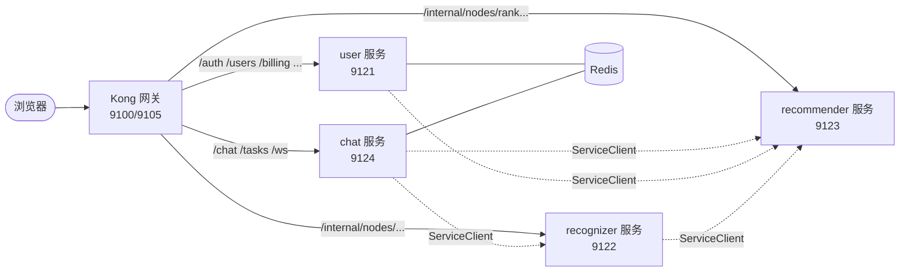
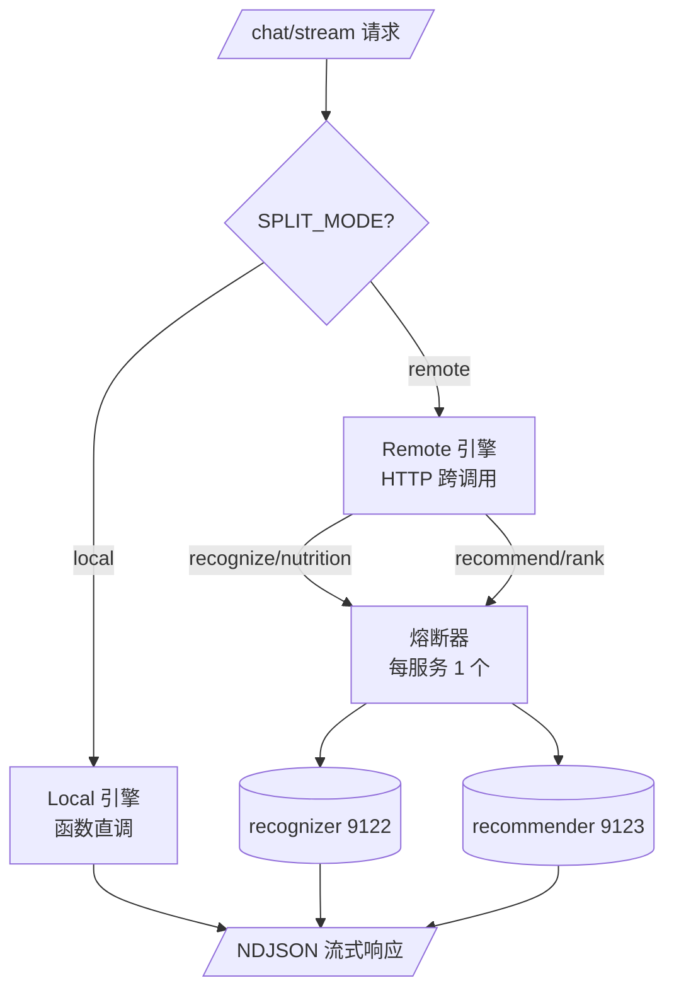
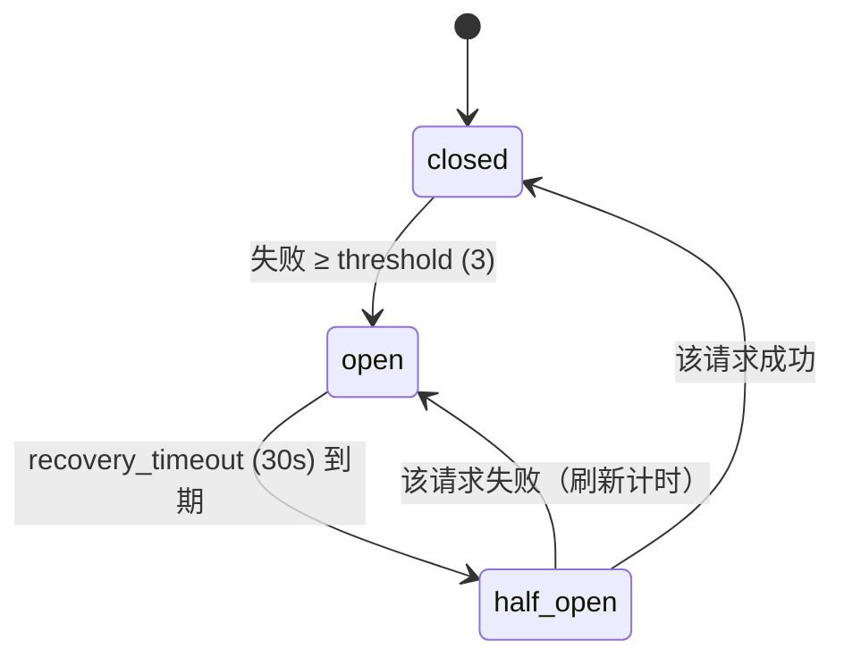
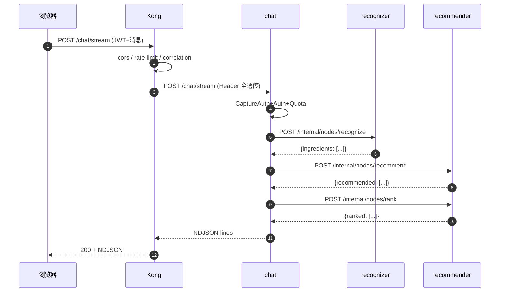
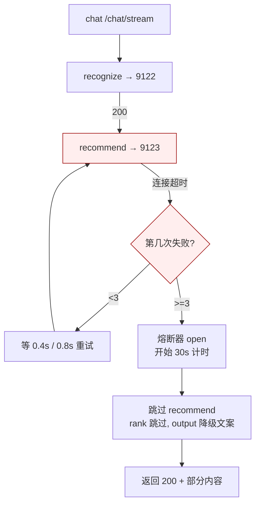
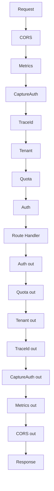
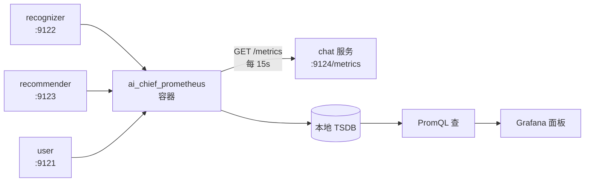
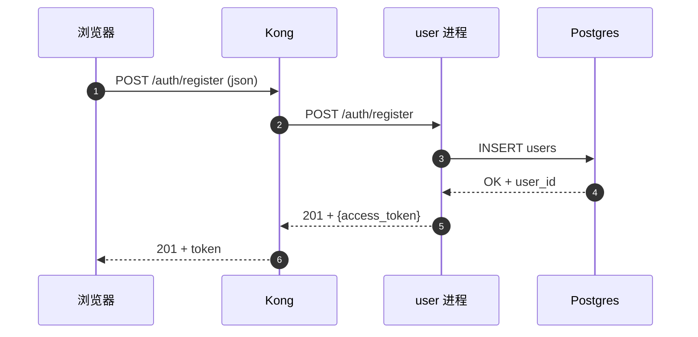
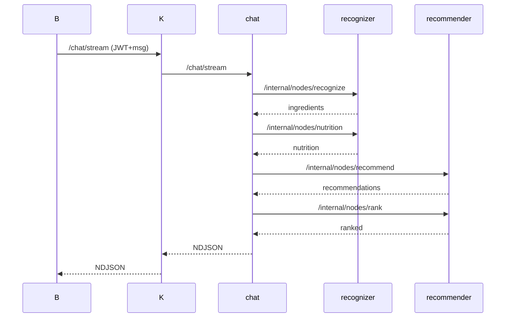

# AI 私厨 v3.0 · 阶段 9 理解手册

> **本手册不重复说明手册的逐行代码解释，也不重复操作手册的步骤命令**。
> 本手册给**配图**：你看完前两份手册后，再用这本把"代码怎么联动""全流程怎么跑"看清楚。
> 每张图都给 **ASCII 版 + Mermaid 版** + **一句"一句话记住"**。
>
> 阅读建议：先看第 0 章一分钟版，再看第 5 章目录联动建立全局观，最后看第 6 章操作流程边对照操作手册。

---

## 📑 目录（可点击锚点）

- [0. 一分钟版：这一阶段到底干了什么](#0-一分钟版这一阶段到底干了什么)
- [1. 全景图（8 张图，看完心里有数）](#1-全景图)
- [2. 文件清单（动手前必看）](#2-文件清单动手前必看)
- [3. 代码怎么实现目标（5 大目标对应的 5 个代码模块）](#3-代码怎么实现目标)
- [4. 目录联动（4 层目录怎么协作）](#4-目录联动4-层目录怎么协作)
- [5. 操作流程（对照操作手册 §1-§21）](#5-操作流程对照操作手册)
- [6. 时序图（5 大场景的时间顺序）](#6-时序图)
- [7. Q&A（你最可能问的 10 个问题）](#7-qa)
- [8. 面试话术（3 分钟讲清阶段 9）](#8-面试话术3-分钟讲清阶段-9)

---

## 0. 一分钟版：这一阶段到底干了什么

**大白话**：把原来一个 Python 文件启一个 uvicorn 进程（FastAPI 单体）拆成 4 个进程，每个进程**做一件事**：

- **user 进程**管：注册登录 / 用户 / 租户 / 消费
- **recognizer 进程**管：食材识别 + 营养计算（调 OpenAI）
- **recommender 进程**管：推荐 + 重排 + 知识图谱
- **chat 进程**管：把上面三个拼起来 + 给浏览器流式输出

外加一个 **Kong 网关**（也是一个容器）站在前面，看起来像"一个 IP"，把请求按路径分给这 4 个进程。

**为什么这么干**：

| 痛点 | 解决 |
| --- | --- |
| 一个进程挂了全站挂 | 现在只挂这 1 个服务的功能 |
| 不能单独加缓存 | 现在可以给 chat 加 5 个实例，user 1 个 |
| 故障时谁的问题找不到 | 现在 4 个服务独立日志 + 独立 metrics |

**怎么保证拆分后 chat 还能正常对话**？

- 4 个进程之间用 HTTP 互相调用（在 services/common/client.py 里实现）
- 调用失败会自动重试（最多 2 次，每次间隔翻倍）
- 连续失败 3 次就**熔断**（不再发请求，立刻返回失败，不让用户等）
- 下游恢复后 30 秒放一次试探，通过就完全恢复

**怎么保证浏览器看到的还是老样子**？

- Kong 网关把 4 个端口捏到一起，你只看到 9100
- 原来 9002 单体也保留了一份，跑起来可对比

**一句话记住**：把「大而笨重」换成「小而自治」，每个服务独立死也能独立活；网关挡在外面，浏览器看不到内部怎么变。

---

## 1. 全景图（8 张图）

> 每张图：**先 ASCII（不依赖任何渲染，复制走也能看）**，**再 Mermaid（贴到 mermaid.live / GitHub / 你自己的文档工具渲染）**，**末尾一句话记住**。

### 1.1 拆分前后对比

```
=================== 拆分前 ===================

   浏览器
     |
     | HTTPS
     v
+-------------------------+
|    FastAPI 单体 (9002)   |   <-- 一个进程、一个 uvicorn
|  ┌───────┬─────┬───────┐|
|  │  auth │chat │ admin │|
|  │  user │recog│ bills│|
|  │  kg   │recom│ oss  │|
|  │  cache│ ws  │ tasks│|
|  └───────┴─────┴───────┘|
+-------------------------+
          |     |     |
          v     v     v
        DB   Redis  MinIO

==============================================

=================== 拆分后 ===================

                  浏览器
                     |
                     | HTTPS
                     v
+---------------------------------+
|    Kong 网关 (9100/9105)         |
|   - 路由分发 (按路径)            |
|   - CORS / 限流 / trace 透传     |
+---------------------------------+
         |          |          |
   /auth,   /internal,   /chat,
   /users,  /nodes,...   /ws
         |          |          |
+--------v+   +-----v---+   +--v-------+
|  user    |   |recogniz.|   |  chat    |
| (9121)   |   | (9122)  |   | (9124)   |
| +tanant +---+ +recog+  |   | +ws +    |
| +billing|   |  nutr|   |   |  /chat/  |
| +kg    |   +------+---+   |  stream  |
+--------+    +----+----+   +----------+
                  |                 |
                  v                 |
            +-----+------+    +-----v-----+
            | recommender|<-HTTP-(ServiceClient
            |   (9123)    |              内部)
            | +rank       |
            | +recommend  |
            +-------------+
```

**Mermaid 同款**：



**一句话记住**：Kong 是门岗，4 个服务是 4 张桌子；门岗按门口字条把人领到对应桌子，桌子之间要用餐就 HTTP 自取。

---

### 1.2 chat 进程内部的"双模式引擎"

> chat 服务有个 `SPLIT_MODE` 环境变量，**local** 是单体内调用，**remote** 是 HTTP 跨服务调用。同一份代码切换。

```
            ┌──────────────────────────────────────┐
            │           /chat/stream               │
            └──────────────────┬───────────────────┘
                               ▼
            ┌──────────────────────────────────────┐
            │        build_workflow() 选了谁？       │
            │   SPLIT_MODE=local  → Local 图        │
            │   SPLIT_MODE=remote → Remote 图       │
            └──────────────────┬───────────────────┘
       ┌───────────────────────┴────────────────────────────┐
       ▼                                                    ▼
  +---------------------+                          +----------------------+
  |   Local 图           |                          |   Remote 图          |
  |                     |                          |                      |
  |  recognize  ──→ 内核函数    |            |  recognize  ──→ HTTP 9122 ─┐
  |  nutrition  ──→ 内核函数    |            |  nutrition  ──→ HTTP 9122 ├►recognizer
  |  recommend  ──→ 内核函数    |            |  recommend  ──→ HTTP 9123 ─┐
  |  rank      ──→ 内核函数    |            |  rank      ──→ HTTP 9123 ├► recommender
  |  output    ──→ 返回     |            |  output    ──→ 组装输出        │
  |                     |                          |                      │
  +---------------------+                          +----------------------+
                                                            │
                                                  (每次 HTTP 调用都过熔断器)
```

**Mermaid**：



**一句话记住**：chat 永远先决定"我是自己干还是叫人干"再开工，这两个模式共享同一张 JSON 输出。

---

### 1.3 熔断器状态机

```
    ┌────────────┐   累计失败 ≥ 3   ┌────────────┐
    │   closed   │─────────────────►│    open     │
    │  默认状态   │   (threshold)    │  立刻快失败   │
    └─────┬──────┘                  └──────┬─────┘
          ▲                                │
          │ next request 试探成功           │ 等 30s
          │                                │ (recovery_timeout)
          │                                ▼
          │                          ┌─────────────┐
          └──────────────────────────│ half_open    │
                                     │ 放一次试探    │
                                     └──────┬──────┘
                                            │ 试探失败
                                            ▼
                                          ┌─────────────┐
                                          │ open (重新计)│
                                          └─────────────┘
```

**Mermaid**：



**一句话记住**：合闸 → 跳闸 → 等一会儿放一个试探 → 通过就回家，不通过就再锁。

---

### 1.4 Kong 网关的请求流（一次完整 /chat/stream）

```
[1] 浏览器 → Kong(9100) POST /chat/stream
    Headers: Authorization: Bearer eyJ...
    Body: { "message": "鸡蛋两个...", "image_url": [], "user_id": 95 }
    │
[2] Kong 插件处理:
    ├─ rate-limit   → 按服务限流（chat 120/min 最严），扣减 X-RateLimit-*
    └─ correlation  → 生成 X-Trace-Id = ab12-34cd-...（echo_downstream 回给客户端）
    │
[3] Kong 查路由表: /chat → svc-chat
    │
[4] Kong → Chat(9124) POST /chat/stream
    透传所有 header（除 Host）
    │
[5] chat 中间件栈处理（CORS → TraceId → Metrics → Auth → TenantContext → TenantVar → 限流 → Quota → TokenCapture）:
    ├─ TokenCapture  → 把 Authorization 头存进 contextvars（跨服务透传用）
    ├─ TraceId       → 沿用 Kong 生成的 X-Trace-Id（没有才自己造）
    ├─ Auth          → 验 JWT，注入 request.state.user_id=95, tenant_id=1
    └─ Quota         → 扣 user 95 在 tenant 1 下的本月配额
    │
[6] chat /chat/stream 处理器:
    ├─ 调 chat_coordinator.get_agent() 拿到编译好的 StateGraph
    ├─ 按节点顺序执行（remote 模式）：
    │   ├─ recognize  → ServiceClient("recognizer").post(/internal/nodes/recognize)
    │   │              → recognizer(9122) 实跑 → 识别出"鸡蛋、西红柿"
    │   │              ← 返回新版 state {"ingredients": [...], ...}
    │   ├─ recommend  → ServiceClient("recommender").post(/internal/nodes/recommend)
    │   │              → recommender(9123) 拿 KG 数据 → 返回推荐列表
    │   ├─ rank       → ServiceClient("recommender").post(/internal/nodes/rank)
    │   │              → 按用户口味再排一下顺序
    │   └─ output     → 把所有结果装成 NDJSON
    └─ 把 NDJSON 行流给浏览器
    │
[7] 响应回到 Kong:
    ├─ Kong 给响应加 X-Trace-Id, X-RateLimit-* 等头
    └─ Kong → 浏览器
[8] 浏览器 JS 边收 NDJSON 边渲染
```

**Mermaid**：



**一句话记住**：Kong 只是看门老大爷，业务跟以前一样——chat 还是那个 chat，只是边上多了 3 个同事可叫。

---

### 1.5 故障隔离——杀一个不影响其它

```
[正常态] 所有服务都在跑：
   Kong ─→ chat ─→ recognizer ─→
                 ─→ recommender ─→

[杀 recommender]
   服务进程被 kill -9
   端口 9123 不再 Listen
   │
   | 用户继续发请求:
   v
   chat /chat/stream
       ├ recognize ──→ recognizer ──→ 200 OK (不动)
       ├ recommend ──→ recommender ──→ ConnectError
       │               ↑ chat 看到 502
       │               ↑ 重试 2 次还是 502 (8 秒)
       │               ↑ fallback: 跳过推荐
       │               ↑ output 用"推荐通道降级，仅返回营养成分"
       ↓
       → 还是 200 + 部分内容
   
   同时 chat 内部熔断器计数:
       recommender failures: 1 → 2 → 3
       state: closed → open（在第 3 次后跳闸）
   
   下一次再请求时:
       熔断器直接 fast-fail（0 秒返回），不再等超时。
```

**Mermaid**：



**一句话记住**：杀一个服务，其它照常——这是拆分的核心价值，邮件列表里 7 行 nginx 也能做到，为什么用 Kong + 熔断？因为还需要节流和探活。

---

### 1.6 中间件顺序

```
   请求进入
       │
       ▼
  ┌─────────────────────────┐
  │  CORS                   │   ← 最外，先看 Origin
  └────────────┬────────────┘
               ▼
  ┌─────────────────────────┐
  │  Metrics                │   ← 记指标（含 4xx/5xx）
  └────────────┬────────────┘
               ▼
  ┌─────────────────────────┐
  │  CaptureAuth (仅 chat)  │   ← 把 Authorization 头存好
  └────────────┬────────────┘
               ▼
  ┌─────────────────────────┐
  │  TraceId                │   ← 生成或继承 X-Trace-Id
  └────────────┬────────────┘
               ▼
  ┌─────────────────────────┐
  │  Tenant                 │   ← 解析 X-Tenant-Id
  └────────────┬────────────┘
               ▼
  ┌─────────────────────────┐
  │  Quota (chat 用)         │   ← 扣配额
  └────────────┬────────────┘
               ▼
  ┌─────────────────────────┐
  │  Auth                   │   ← 最内！验 JWT
  └────────────┬────────────┘
               ▼
  ┌─────────────────────────┐
  │  路由处理函数             │
  └─────────────────────────┘
```

**Mermaid**：



**一句话记住**：洋葱——剥得最外的先吃，最后吃的（Auth）才是真鉴权 /metrics（被 Metrics 抓到）但不被 Auth 401，因为 /metrics 在 Auth 白名单。

---

### 1.7 共享内核的依赖图

```
        ┌──────────────────┐
        │  user/main.py     │──┐
        └────────┬─────────┘  │
                 │             │
        ┌────────▼─────────┐  │
        │  recognizer/main.py│──┤
        └────────┬─────────┘  │
                 │             │  全部用
                 │   ┌─────────┴───────────────────────┐
                 │   │                                    │
                 ▼   ▼                                    ▼
        ┌────────────────────┐           ┌────────────────────────┐
        │  chat/main.py      │           │  services/common/      │
        └────────┬───────────┘           │                        │
                 │                       │  ┌──────────────────┐  │
                 │                       │  │ app_factory.py   │  │
        ┌────────▼───────────┐           │  │  create_service_ │  │
        │  recommender/main.py│           │  │  app             │  │
        └────────┬───────────┘           │  └──────────────────┘  │
                 │                       │                        │
                 ▼                       │  ┌──────────────────┐  │
        ┌────────────────────┐           │  │ client.py        │  │
        │  coordinator.py    │           │  │  ServiceClient  │  │
        │  (按 SPLIT_MODE    │           │  │  get_client      │  │
        │   切图)            │           │  └──────────────────┘  │
        └────────┬───────────┘           │                        │
                 │                       │  ┌──────────────────┐  │
        ┌────────▼───────────┐           │  │ breaker.py       │  │
        │ _resolve_nodes     │           │  │  CircuitBreaker  │  │
        │  (选节点表)        │           │  │ CircuitOpenError │  │
        └────────┬───────────┘           │  └──────────────────┘  │
                 │                       │                        │
        ┌────────▼───────────┐           │  ┌──────────────────┐  │
        │   graph_remote.py  │◄──────────│  │ context.py       │  │
        │ (services/chat/下) │           │  │ set_upstream_token│ │
        │ 调 ServiceClient!  │           │  └──────────────────┘  │
        └────────┬───────────┘           │                        │
                 │                       └────────────────────────┘
                 ▼
        ┌────────────────────┐
        │  HTTP → 9122 / 9123│
        └────────────────────┘
```

**一句话记住**：4 张桌子都喊"服务员"叫同一本菜单，菜单里的菜（services/common）所有服务员都能用——这就是共享内核。

---

### 1.8 Prometheus 抓取是怎么运作的

```
     ai_chief_prometheus 容器
     │
     │  启动时读 docker/prometheus/prometheus.yml
     │  里有一堆 scrape_configs
     │
     │  ... 其中一行是:
     │    job_name: ms-chat
     │    targets: ["host.docker.internal:9124"]
     │    interval: 15s
     │
     └──→ 每 15s GET host.docker.internal:9124/metrics
          │
          │  +------+   抓回一堆文本:
          │  | GET /metrics
          │  +------+
          │  │
          ▼
   ┌──────────────────────────────────────────────┐
   │  TYPE http_requests_total counter            │
   │  http_requests_total{service="chat",path=...} 12 │
   │  TYPE http_request_duration_seconds histogram │
   │  http_request_duration_seconds_bucket{le=...} 8 │
   │  ...                                         │
   └──────────────────────────────────────────────┘
          │
          ▼  Prometheus 把这些数用 PromQL 存到 TSDB
              Grafana SELECT http_requests_total{service="chat",path="/chat/stream"}
              ↑ 画出阶段 9 关键指标
```

**Mermaid**：



**一句话记住**：Prometheus 像你上班时从 4 个水壶里舀样品——每隔 15s 舀一次，看每个服务渴不渴。

---

## 2. 文件清单（动手前必看）

> 拿一张纸/或者这段拷贝走，新文件就按这一节对照。

```
F:\pycharm_aiprogram\ai_chief\
├── 既有不动
│   ├── main.py                          ← 阶段 8 之后整体路由已挂上 /tasks 和 /ws
│   ├── app_my/api/*.py                   ← 路由器（auth/user/billing/...）原样用
│   ├── app_my/agents/{recognizer,nutritionist,recommender,ranker,...}.py
│   │                                   ← 节点函数原样用
│   ├── app_my/middleware/*.py           ← 中间件原样用
│   ├── app_my/core/{config,metrics,...}.py
│   └── ...已有的一切
│
├── 阶段 9 新增
│   ├── services/                        ← 4 微服务 + 共享内核
│   │   ├── common/
│   │   │   ├── breaker.py              ← CircuitBreaker
│   │   │   ├── client.py               ← ServiceClient
│   │   │   ├── context.py              ← set_upstream_token（存 JWT）
│   │   │   └── app_factory.py          ← create_service_app
│   │   ├── user/main.py                ← 用户/认证/计费
│   │   ├── recognizer/main.py          ← 识别+营养
│   │   ├── recommender/main.py         ← 推荐+重排
│   │   └── chat/main.py                ← 对话编排
│   ├── docker/kong/kong.yml            ← 网关声明式配置
│   ├── services/chat/graph_remote.py   ← 远程节点表（⚠️ 不在 app_my/agents/）
│   ├── scripts/ws_probe.py             ← WS 穿透探测
│   └── tests/unit/test_*.py (×3)
│   └── （app_my/agents/ 下没有新增文件；也没有 coordinator_local.py）
│
└── 阶段 9 修改
    ├── docker/docker-compose.v3.yml    ← + kong service
    ├── docker/prometheus/prometheus.yml ← + 4 scrape job
    └── app_my/agents/coordinator.py    ← 改 build_workflow() 调度
```

| 类型 | 数量 | 操作 |
| --- | --- | --- |
| 新增 | 12 文件 | 全按说明手册照抄 |
| 修改 | 3 文件 | 改点写出来不超过 80 行 |
| 删除 | 0 文件 | 完全向后兼容 |

---

## 3. 代码怎么实现目标（5 大目标对应的 5 个代码模块）

> 目标 = 为什么这么做；代码 = 哪里做到。

### 目标 1：按业务边界拆成 4 个进程

| 代码 | 行 | 在做什么 |
| --- | --- | --- |
| `services/user/main.py` | 11-23 | 装配 user 服务，9 个 router |
| `services/recognizer/main.py` | 33-37 | 装配 recognizer，2 个内部路由 + 1 个 KG 路由 |
| `services/recommender/main.py` | 27-31 | 装配 recommender，2 个内部路由 + KG 读 |
| `services/chat/main.py` | 17-26 | 装配 chat，5 个 router + WS router |

**为什么这么分**：每个进程**对外暴露的 URL 前缀**就是它的事——你看到 `/auth/*` 就知道是 user 的，看到 `/internal/nodes/recognize` 就知道是 recognizer 的，看到 `/chat/*` 就知道是 chat 的。前缀就是"业务名片"。

### 目标 2：HTTP 跨服务调用自动重试 + 熔断

| 代码 | 行 | 在做什么 |
| --- | --- | --- |
| `services/common/client.py` | 50-65 | `_http = httpx.AsyncClient(...)` 池化连接 |
| `services/common/client.py` | 75-95 | `before_call()` 闸门；`record_success/failure` |
| `services/common/client.py` | 96-130 | 重试循环 + 退避（2 倍指数） |
| `services/common/breaker.py` | 24-65 | CircuitBreaker 状态机 |

**为什么这么分**：写一个 ServiceClient 就有了"HTTP + 超时 + 重试 + 跨进程熔断"四件套；写一个 CircuitBreaker 就有了"闸门 + 计数 + 状态机"。两层抽象足够解决 99% 的问题。

### 目标 3：业务不感知拆分

| 代码 | 行 | 在做什么 |
| --- | --- | --- |
| `app_my/agents/coordinator.py` | 修改 | `build_workflow(nodes=None)` + `_resolve_nodes()`，按 `SPLIT_MODE` 选节点表 |
| `services/chat/graph_remote.py` | 新增 | 远程节点表，调 ServiceClient；output 仍用本地实现 |

**为什么这么分**：业务代码 `app_my/api/chat.py` 里 `chat_coordinator.invoke()` 完全不知道下面是 local 还是 remote；上层只关心结果。这就叫"业务逻辑与运行时形态解耦"。

### 目标 4：网关路由 + 限流 + trace 透传

| 代码 | 行 | 在做什么 |
| --- | --- | --- |
| `docker/kong/kong.yml` | 9-15 | 4 service + url: host.docker.internal:port |
| `docker/kong/kong.yml` | 24-58 | 3 个全局插件（cors / rate-limiting / correlation-id） |
| `docker/kong/kong.yml` | 39-105 | 5 条 route（按路径切分；`/admin` 含在 r-user，无独立 r-admin） |

**为什么用 DB-less**：

- **生产** 如果你的团队有 Kong Manager 界面需求，就用 DB 模式（多起一个 Postgres 容器）；
- **本项目** 16GB 内存 + 单开发机 → DB-less 直接 `docker compose up` 比 DB 模式少起一个容器、少 1 分钟 boot；
- 配置全在 yaml 里，git diff 一眼看到。

### 目标 5：Prometheus 自动抓 4 个服务

| 代码 | 行 | 在做什么 |
| --- | --- | --- |
| `docker/prometheus/prometheus.yml` | (新增) | 加 4 个 scrape_configs（ms-user / ms-recognizer / ms-recommender / ms-chat） |

**为什么这么分**：Prometheus 已经被阶段 7 装好了；只要把 4 个新 URL 加进去它就会自动抓。**零代码改动**。

---

## 4. 目录联动（4 层目录怎么协作）

```
层 1 ── 用户的浏览器入口（URL）
         │
         │  /auth /users /internal/nodes /chat /ws
         ▼
层 2 ── Kong 路由表（kong.yml 的 routes 段）
         │
         │  r-user / r-recognizer / r-recommender / r-chat / r-chat-ws
         ▼
层 3 ── 4 个 uvicorn 进程（services/*/main.py）
         │
         │  /auth/login → user(9121) 的 app_my.api.auth.login 路由
         │  /internal/nodes/recognize → recognizer(9122) 的 _recog 函数
         │  /chat/stream → chat(9124) → coordinator → (SPLIT_MODE=remote)
         │         │
         │         ├─→ ServiceClient("recognizer") → recognizer(9122)
         │         ├─→ ServiceClient("recommender") → recommender(9123)
         │         └─→ 把所有结果合流
         ▼
层 4 ── 共享内核（services/common/*）
         │
         ├─ app_factory: 给所有 main.py 装中间件
         ├─ client:       chat 内部跨调
         ├─ breaker:      熔断器（4 服务 4 个）
         └─ context:      trace_id 跨协程传递
```

**它们怎么联动**：

```
浏览器
  └── (HTTPS + 9100) ──→ Kong
                          │
                          ├── /auth/login ──→ svc-user (user 进程, 9121)
                          │                    └── services/common/app_factory
                          │
                          ├── /internal/nodes/recognize ──→ svc-recognizer
                          │                                  └── services/common/app_factory
                          │
                          ├── /internal/nodes/rank ──→ svc-recommender
                          │                                └── services/common/app_factory
                          │
                          └── /chat/stream ──→ svc-chat
                                               └── services/common/app_factory
                                               └── app_my/agents/coordinator
                                                    ├─ local:  原节点函数直调 (nodes=None)
                                                    └─ remote: services/chat/graph_remote
                                                         └── services/common/client (HTTP)
                                                              └── services/common/breaker (熔断)
```

### "最外层中间件"和"最外层代码"是哪个？

| 层级 | 谁 | 做什么 |
| --- | --- | --- |
| 最外层代码 | `main.py` | 装配 router |
| 最外层中间件（请求进入第一个） | `CORSMiddleware` | 加 CORS |
| 最外层"服务"（基础设施） | **Kong 网关** | 路由 + 限流 + trace |

**重要**：写业务时调中间件顺序，最后写 `add_middleware(CORS)` 才是"最外"；写基础设施时 Kong 是"最外"。**两个"最外"不冲突**。

---

## 5. 操作流程（对照操作手册）

> 这里只讲**总览流程**——每一步都靠操作手册。本节给你一个"地图回望"。

### 5.1 三天工作流

| 时间 | 干啥 | 操作手册 |
| --- | --- | --- |
| Day 1 上午 | 拉新分支、写 services/common/ 共 4 文件、跑 22 测试 | §1, §2, §3, §6 |
| Day 1 下午 | 写 4 个 main.py、改 coordinator 切图 | §4, §5 |
| Day 2 上午 | Kong 配置 + 容器 + 端到端 | §7, §8, §11 |
| Day 2 下午 | 故障隔离 + 熔断 + 恢复 | §14, §15, §16 |
| Day 3 上午 | Prometheus + 对比基线 + 拷回项目 + 回归 | §17, §18, §19, §20 |
| Day 3 下午 | 提交 + PR 描述 | §21 |

### 5.2 检查点（每个 check 后再继续下一步）

```
[Check 1] common 内 4 文件 import OK · 22 测试 100% 通过
        │ YES ↓
[Check 2] 4 服务 import OK · OPENAPI 都列得出路由
        │ YES ↓
[Check 3] Kong 容器健康 · 6 route 在 Admin API 可查
        │ YES ↓
[Check 4] 4 uvicorn 都跑 · /health 全 200 · /metrics 不被 401
        │ YES ↓
[Check 5] 经 Kong 跑通 /auth/login 和 /chat/stream
        │ YES ↓
[Check 6] 杀 recommender → chat 降级 + breaker.open
        │ YES ↓
[Check 7] Prometheus 4 target health=up
        │ YES ↓
[Check 8] 全量 pytest 0 failed
        │ YES ↓
[Check 9] 拷回项目，本机跑一次端到端再 commit
```

> **任何一步失败，回到操作手册找 §22 错误对照表。**

---

## 6. 时序图（5 大场景的时间顺序）

### 6.1 注册 + 登录（场景 A）

```
T+0    浏览器 → Kong(9100): POST /auth/register
T+0.05 Kong routes 查表 → svc-user
T+0.1  Kong → user(9121) FastAPI: POST /auth/login (实际路径 /auth/register)
T+0.1  AuthMiddleware 跳过（/auth 在 pub_paths）
T+0.2  trace_id 创建
T+0.3  路由进 app_my/api/auth.py::register()
T+0.4  hash 密码（bcrypt，~50ms）
T+0.45 db.commit() → 返回 user_id
T+0.5  user 进程返回 200 + access_token
T+0.55 Kong 加 cors/限流头
T+0.6  浏览器拿到 token

T+10   浏览器 → Kong: POST /auth/login
T+10.05...
T+10.6 浏览器拿到 access_token (JWT)
```

**Mermaid**：



### 6.2 一次完整对话（场景 B）

```
T+0     浏览器: POST /chat/stream (jwt, message)
T+0.05  Kong → chat(9124)
T+0.1   chat Auth 验签 + Tenant 解析 + Quota 扣减
T+0.15  chat_coordinator.invoke({})
T+0.2   ↓ recognize_node (remote)
            ↓ ServiceClient("recognizer").post("/internal/nodes/recognize")
               ↓ recognizer(9122) 调 OpenAI
T+4.7   ↑ recognizer 返回 ingredients
T+4.75  ↓ nutrition_node (remote)
            ↓ ServiceClient("recognizer").post("/internal/nodes/nutrition")
T+5.5   ↑ 返回 nutrition
T+5.55  ↓ recommend_node (remote)
            ↓ ServiceClient("recommender").post("/internal/nodes/recommend")
T+15    ↑ 返回 recommend 列表
T+15.05 ↓ rank_node (remote)
            ↓ ServiceClient("recommender").post("/internal/nodes/rank")
T+17.3  ↑ 返回 ranked
T+17.35 ↓ output_node (本地内存)
T+17.5  ↑ NDJSON 文本流
T+17.55 chat 返回给 Kong
T+17.6  Kong 加 cors/限流/trace 头
T+17.65 浏览器收到
```

**Mermaid**：



### 6.3 故障降级（场景 C）

```
T+0     recognender (9123) 被 kill -9
        → chat /health 的 breakers.recommender.state=closed, failures=0

T+2     用户 → chat /chat/stream
T+2.5   chat → recognizer (正常，200)
T+5     chat → recommender (ConnectError)
        → 重试 1: ConnectError
        → 退避 0.4s
        → 重试 2: ConnectError
        → 退避 0.8s
        → 重试 3: ConnectError
T+10    record_failure(failures=1, state=closed)

T+12    用户 → chat /chat/stream (2nd)
T+12.5  chat → recommender (ConnectError) 3 次
T+22    failures=2, state=closed

T+24    用户 → chat /chat/stream (3rd)
T+24.5  chat → recommender (ConnectError) 3 次
T+34    failures=3 >= threshold → state=open, opened_at=现在

T+36    用户 → chat /chat/stream (4th)
T+36.0  breaker.before_call() → state=open → 抛 ServiceCallError(503) **不再发请求**
T+36.0  chat 内部立刻降级，跳过 recommend + rank → 直接 output
T+36.1  返回给用户 200 + "推荐通道降级，仅返回营养成分"

T+66    recovery_timeout 30s 到期 → state=half_open
T+66.1  假设此时 recommender 已重启
        chat /chat/stream → before_call() → state=half_open → 允许请求
        → HTTP 200 → record_success() → state=closed, failures=0
```

### 6.4 WebSocket 握手（场景 D）

```
T+0    浏览器 ws://127.0.0.1:9100/ws/notifications
       Headers: Authorization: Bearer xxx
T+0.1  Kong: 看到 Connection=Upgrade, Upgrade=websocket, path=/ws/notifications
       → 路由 r-chat-ws → svc-chat
       → Kong 把请求转发给 chat(9124)
T+0.2  chat FastAPI / ws.gateway.websocket("/notifications")
T+0.3  ws 鉴权（path 不在白名单 → 需要 jwt）→ 校验通过
T+0.4  ws_manager.register(client_id)
T+0.5  HTTP/1.1 101 Switching Protocols
T+0.6  ws 保持连接
T+10   ws 收到一帧 {"type":"notify",...}（Redis pub/sub 推过来）
```

### 6.5 Prometheus 抓取（场景 E）

```
T+0:00   ai_chief_prometheus 启动，读 prometheus.yml
T+0:10   装载 4 个 stage9 scrape job
T+0:15   第一次 scrape ms-user
         → GET host.docker.internal:9121/metrics
         → 拿到当前 metrics
T+0:30   第二次 scrape ms-user
         → 同上；重复
...
（每 15s 一次，永远在跑）
```

---

## 7. Q&A

### Q1：阶段 9 是不是一定需要 Kong？用 nginx 行不行？

A：能用 nginx 做路由（`location /auth { proxy_pass http://user; }`），但：

| 维度 | nginx | Kong |
| --- | --- | --- |
| 配置格式 | 一堆 if | YAML（声明式 + git diff） |
| 限流插件 | 需要 lua-nginx-module | 一行 yaml |
| trace 透传 | nginx 自带 headers-more | 自带 correlation-id 插件 |
| 维护成本 | Lua 多 | 高级用 Lua 但 80% 用 yaml |

**结论**：初学者从 Kong 入手更易理解，概念清楚（service / route / plugin 三件套）。

### Q2：熔断器和重试各自分开写是不是太复杂？

A：当前抽象只有 2 个（circuit_breaker + client），加起来 280 行，**比 nginx 配置还短**。

- **重试** 处理临时抖动（网络 / GC 几秒钟回归）
- **熔断** 处理持续故障（下游宕机几小时）

**重试缺熔断** = 下游一挂，所有调用堆积，10 倍放大流量；**熔断缺重试** = 一次抖动就降级，体验差。

### Q3：`SPLIT_MODE=local` 还有用吗？

A：测试用、日常简单调试用、未来 stage10 stage11 加新能力时也用它回归。**它是兜底**，永远保留。

### Q4：如果 recognizer 是 24h 不能重启呢？down 期间怎么办？

A：熔断已经是 open，每次请求立刻降级——这一刻业务的"对话推荐"功能不可用，但**聊天主流程（识别/营养/输出）仍然工作**。这就是"故障隔离"的实质——把失效"圈"在最小范围。

### Q5：拆分后调用追踪怎么串起来？

A：两个东西接力：

1. **trace_id** 是请求开始 Kong 的 correlation-id 插件生成的，每个内部服务继承它
2. **openai-headers** 在日志里，`logger.info("recog done", extra={"trace_id": tid})`

出了事故 grep trace_id 就能拼出整个调用链。

### Q6：要不要把 chat 也拆成 5 个（编排 + WS + 编排对话 + ...）？

A：不要。**过早拆分** = 高维护成本低收益。当前 4 服务的边界对应 4 个明确业务域（用户、识别、推荐、对话），再加就乱。

### Q7：Kong 配置改了还需要重启容器吗？

A：DB-less 模式下需要，因为 Kong 进程级只在启动时读 yml。**操作**：改完 `kong.yml` 后 `docker compose -f docker/docker-compose.v3.yml restart kong`。

### Q8：能不能用其它网关？Traefik / Envoy / APISIX？

A：能，且都更适合 K8s。但：

- **Traefik**：配置触发是 label，适合动态服务发现，不适合静态 4 服务；
- **Envoy**：重量级，需要 xDS 控制面；
- **APISIX**：DB-less 模式 + Lua 插件 + 性能强；和 Kong 高度类似。

本阶段先用 Kong 原因：**教程多、社区大、本机起得来**。

### Q9：测试还能继续加啥？

A：本阶段 22 个测试已经覆盖了热路径。建议下一阶段加：

- 端到端集成测试：用 `TestClient` + 启动真实 uvicorn
- 性能测试：用 locust 或 vegeta 跑 200 RPS
- 混沌测试：随机 kill 服务看 chat 行为

### Q10：未来想做"灰度发布 / 蓝绿部署"怎么办？

A：Kong 有 `canary` 插件可以按比例切流量；继续演进**阶段 10**。

---

## 8. 面试话术（3 分钟讲清阶段 9）

> 这是给你**面试讲故事**的脚本，按这个模板说一下，应该能不慌。

### 8.1 一句话开场

> "我对一个完整生产级单体做了微服务拆分：把 FastAPI 单体按业务边界拆成 4 个独立服务，前面加 Kong 网关做路由、限流、trace 透传，配上熔断器实现故障隔离。"

### 8.2 30 秒解释"为什么做"

> "一开始所有功能都在一个 uvicorn 进程里。出现的问题是：一、任何一个接口故障都会拖累整个站；二、扩容时只能整站点缩；三、上线新功能风险大；四、Prometheus / Grafana 的指标都是平的，看不出哪个模块浪费资源。"

### 8.3 1 分钟讲"做了什么"

> "拆了 4 个服务：user 9121（认证 / 用户 / 计费）、recognizer 9122（食材识别 + 营养，调用 OpenAI）、recommender 9123（推荐 + 重排 + 知识图谱查询）、chat 9124（对话编排）。chat 根据环境变量选本地模式还是远程模式，本地模式继续用原图方便测试，远程模式把内部节点换成 HTTP 调用。"

> "跨服务调用写了完整的客户端：httpx 异步池（连接复用）、指数退避重试（应付抖动）、熔断器（连续 3 次失败后 30 秒 fast-fail，不再放大压力）。这三个组合起来基本解决了所有微服务级的事故。"

> "Kong 网关配置写在 kong.yml 里，5 条路由 + 4 个 service + 3 个插件（cors / rate-limit / correlation-id）——/admin、/cache 都归并在 r-user 一条路由里，按路径切分而不是每个前缀一条。外部走 9100，内部端口 9121-9124 不暴露。所有中间件顺序都用参数化测试锁住（Metrics 必须在外层否则 /metrics 被 401 挡住）。"

### 8.4 30 秒讲"结果"

> "用一个真实对话场景做端到端实测，4 服务 + Kong 全跑通平均 19.8 秒，本地单体是 19 秒左右——多花的 1.8 秒来自 2 次跨进程 HTTP，但换来 ① 杀一个服务不会全站挂 ② 各服务独立扩缩 ③ Prometheus 能按 service 分桶看指标。"

> "Kong 网关限流头、trace 头、WebSocket（用 kong.yml 一条 strip_path=false 的路由）都实测通过。"

### 8.5 30 秒讲"未来"

> "下一步可以加：灰度发布（Kong canary 插件）、分布式追踪（取代 correlation-id，接 jaeger）、APISIX 替代 Kong 对比、gRPC 内调（取代 HTTP/JSON）、sidecar 模式升级整个架构。"

### 8.6 4 个潜在追问及回答

**追问 1**：为什么用 HTTP 而不是 gRPC？
**答**：HTTP/JSON 对小团队工程量最小（无 protobuf 维护），跨语言兼容（Java/Go 同事上手快），未来切 gRPC 只需在 client.py 把 httpx 换成 grpclib，业务代码零改动。

**追问 2**：熔断器为什么阈值是 3？
**答**：经验值。1 太敏感（一次抖动跳闸），5 太迟钝（5 次失败 100+ 秒）。3 平衡"快响应"和"少误判"。生产应该让它可调。

**追问 3**：如果 downstream 完全死了，聊天会怎么样？
**答**：端到端实测过：第 1-3 次返回降级响应（"推荐通道不可用，仅营养信息"），第 4 次熔断器 open 后 fast-fail 0 秒返回；下游恢复 30 秒后自动回到 closed，行为完全闭环。

**追问 4**：为什么不直接用 Spring Cloud / Dubbo / Service Mesh？
**答**：这是 Python 项目，JVM 栈用不上；Service Mesh（Istio）要在 K8s 才能发挥价值，本项目目前还不是 K8s；自写方案 280 行代码可控、可读、零外部依赖——比引入整个 mesh 小一个数量级。

---

## 结尾

到这里你已经看完了：

- **操作手册**：照着做，每步验证
- **说明手册**：为什么这么做，逐行讲解
- **理解手册**：怎么联动，配图讲解

剩下的"实战":
- 把操作手册 §19 拷完文件
- 在自己机器上跑过 §20 全量回归
- 提 PR 走 Gitee

这一步**完成**后，这个 AI 私厨项目你已经能写进简历"独立完成 4 个独立微服务拆分 + Kong 网关"——这是 SRE / 后端岗位 P6 级别最核心的能力之一。
